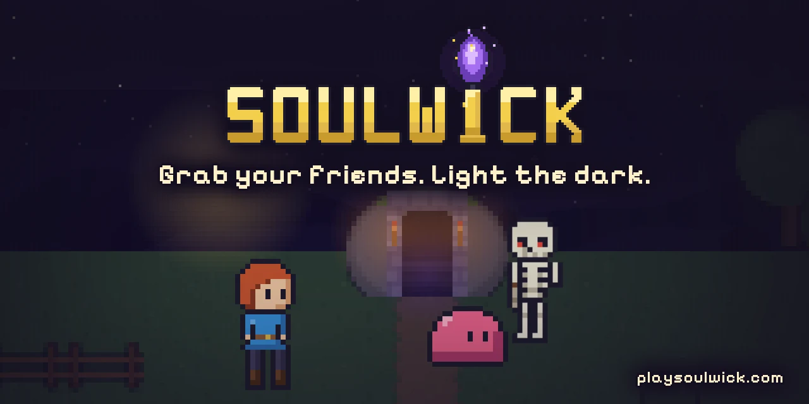
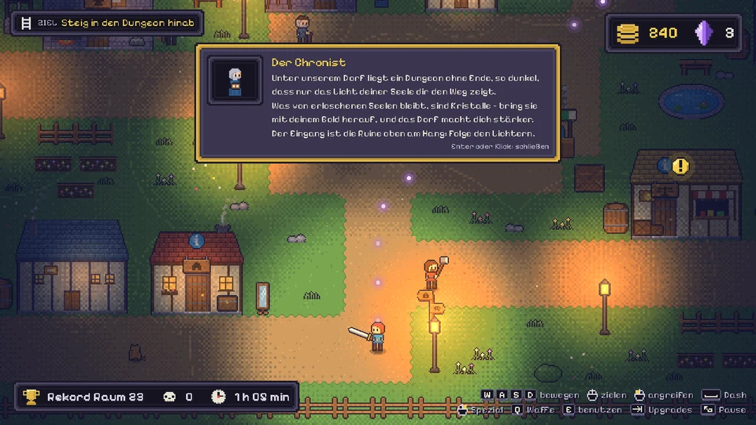
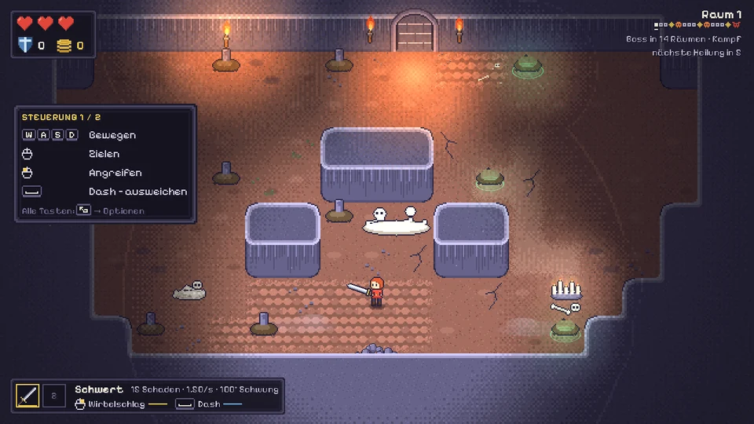
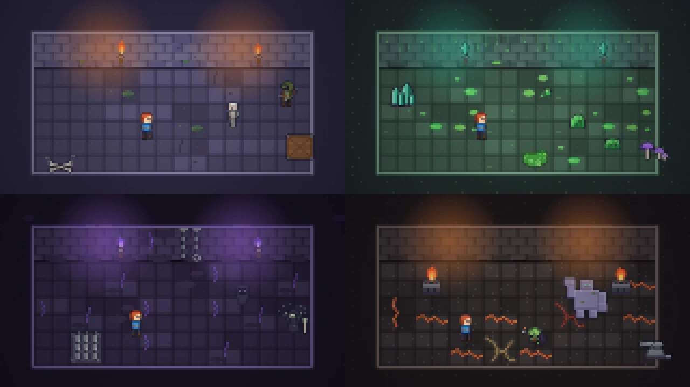

<div align="center">

<a href="https://playsoulwick.com"></a>

# Soulwick

**Grab your friends. Light the dark.**

The pixel roguelite you jump into with your friends – every run different, every boss a clip.

[](https://github.com/WebBude-de/soulwick/actions/workflows/ci.yml)
[](https://godotengine.org/download/archive/4.7.2-stable/)
[](LICENSE)
[](LICENSE-ASSETS.md)
[](https://playsoulwick.com)
[](https://github.com/WebBude-de/soulwick/releases)

**[Website](https://playsoulwick.com)** ·
**[Play in your browser](https://game.playsoulwick.com)** (from release) ·
[Leaderboards](https://playsoulwick.com/leaderboards) (from release) ·
[Downloads](https://github.com/WebBude-de/soulwick/releases) ·
[Platform repo](https://github.com/WebBude-de/soulwick-platform) ·
[Docs (German)](docs/README.md)

</div>

> 🇩🇪 Die Projektdokumentation ist auf Deutsch: [docs/README.md](docs/README.md). Issues and pull
> requests are welcome in English or German.

## What is Soulwick?

A modern pixel-art roguelite you start in a minute and play with your friends for hours. Grab a
weapon, bring light into the dark and fight your way down a dungeon that never ends. Easy to pick up,
hard to master.

- **An endless descent.** Room after room, a boss every 15 rooms, then a campfire and a new biome:
  Crypt, Slime Grotto, Shadow Realm, Ember Forge – and down again, harder.
- **Not every room is a fight.** Arenas, ambushes and mini-game rooms shake up every run.
- **Weapons and upgrades.** Sword, bow, mage staff, daggers and war hammer, each with a special attack,
  plus upgrades to build your run.
- **Your village.** Bring your gold home, grow stronger for good at the forge, stock up on
  provisions at the trading post and change your look at home; invite friends to visit your village
  (in development, part of the release).
- **Together.** Co-op for 2 to 4 players with a room code or an invite link, guilds and leaderboards
  – in development, part of the release.
- **Play anywhere.** Mouse and keyboard, gamepad or touch; Windows, Linux, macOS, Android and the
  browser.
- **Coming with the release:** AI bosses (wish for a boss, then fight it – the clip machine) and
  Wick, the little wick creature that keeps you company from your first run.
- **After the release:** a party mode with mini-games head to head.

<table>
  <tr>
    <td width="50%"></td>
    <td width="50%"></td>
  </tr>
  <tr>
    <td colspan="2"></td>
  </tr>
</table>

<sub>Work in progress: screenshots from the current development build (German interface).</sub>

## Status

Soulwick is **in development** (version 0.9). Every push to `dev` publishes a test build as a
pre-release on [GitHub Releases](https://github.com/WebBude-de/soulwick/releases) for Windows, Linux,
macOS and Android; from the release on, the browser version runs at
[game.playsoulwick.com](https://game.playsoulwick.com). Test builds talk to test servers, so expect
bugs and resets. Steam, Google Play and the App Store are planned.

Found a bug or have an idea? In test builds press **Ctrl + B** (**Cmd + B** on a Mac), **F9** or
**#**, press Back + Start together on a gamepad or tap the bug button on your phone, mark the spot and
send it – or [open an issue](https://github.com/WebBude-de/soulwick/issues/new/choose).

## Controls

| Action | Mouse and keyboard | Gamepad |
| --- | --- | --- |
| Move / aim | WASD / mouse | left stick / right stick |
| Attack / special attack | left mouse button (hold) / right mouse button | RT / LT |
| Dash (jump in side-view rooms) | Space | A |
| Dash in side-view rooms | Shift | B |
| Interact / switch weapon | E / Q | X / Y |
| Upgrades / pause | Tab / Esc | Back / Start |
| Fullscreen / report a bug or idea (test builds) | F11 / Ctrl + B (Cmd + B on macOS), F9 or # | – / Back + Start together |

On phones and tablets the game shows two on-screen sticks; size, layout and opacity are in the
options.

## Build from source

You need [Godot 4.7.2 stable, standard version](https://godotengine.org/download/archive/4.7.2-stable/)
(not .NET; exactly this version) and [Git LFS](https://git-lfs.com) for the audio files.

```bash
git lfs install
git clone https://github.com/WebBude-de/soulwick.git
```

Start Godot, choose **Import**, select `project.godot` in the cloned folder (the first import takes a
while) and press **F5**. The game runs without a server; online features started from the editor look
for a local [soulwick-platform](https://github.com/WebBude-de/soulwick-platform) and otherwise stay
offline. Exports and releases: [docs/RELEASE.md](docs/RELEASE.md) (German).

## Tests

`godot` is the path to your Godot 4.7.2 executable. The same checks run on every pull request.

```bash
godot --headless --audio-driver Dummy --path . --import                          # first time only
godot --headless --audio-driver Dummy --path . -s tools/validate_project.gd      # every file loads
godot --headless --audio-driver Dummy --path . -s addons/gut/gut_cmdln.gd -gexit # unit tests (GUT)
```

A few tests expect German as the system language (CI sets `LANG=de_DE.UTF-8`). Smoke test, combat and
boss simulations and the balance bot: [AGENTS.md](AGENTS.md) §7.

## Project structure

| Folder | What |
| --- | --- |
| `scenes/`, `autoload/` | entry scenes and the four global services |
| `dungeon/`, `world/village/` | dungeon, rooms and mini-games; the village |
| `player/`, `enemies/`, `weapons/`, `upgrades/`, `components/` | gameplay |
| `economy/`, `meta/`, `online/` | gold, progression and saves, online client |
| `ui/`, `localization/` | menus and HUD; English and German texts |
| `art/`, `audio/` | artwork, music and sound (all rights reserved) |
| `tests/`, `tools/` | GUT tests; checks, simulations, generators, build scripts |
| `deploy/`, `Dockerfile` | browser version |
| `docs/` | documentation (German) |

## Contributing

Bug reports, ideas and pull requests are welcome – read [CONTRIBUTING.md](CONTRIBUTING.md) first. We
follow the [Code of Conduct](CODE_OF_CONDUCT.md). Security issues go through
[SECURITY.md](SECURITY.md), not public issues.

## License

- **Code:** GPL-3.0-or-later, see [LICENSE](LICENSE).
- **Content:** artwork, music and sound, the logo, the name "Soulwick" and the characters (Wick, the
  chicken) are © WebBude, all rights reserved – see [LICENSE-ASSETS.md](LICENSE-ASSETS.md). Forks
  that publish a game bring their own content and name.
- **Videos and streams** of Soulwick are welcome, monetized ones included.
- Third-party parts (Godot, GUT, Pixelify Sans): [THIRD_PARTY.md](THIRD_PARTY.md).

<div align="center">

Made with ♥ by [WebBude](https://web-bude.de)

</div>
