# Raumarten – Look

## Säubern · „Besiege alle Gegner.“

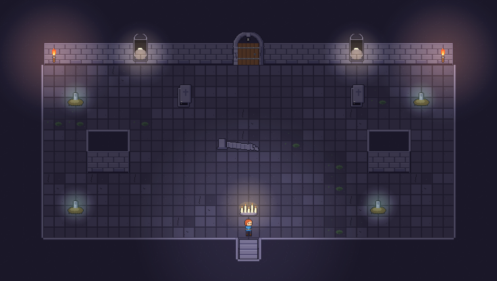

- **Biom im Mockup:** Krypta
- **Fantasie:** Eine Grabhalle: Gräber in zwei Reihen entlang der Wände, ein Sarg links und rechts, eine eingestürzte Säule als Deckung, eine Opferstelle mit Kerzen.
- **Bau:** 23×13, Rechteck mit zwei kurzen Innenmauern als Deckung. Gräber (Quellen) in den Ecken und hinter dem Eingang, damit Gegner auch von hinten kommen. 1–2 Schübe.
- **Gegner-Auftritt:** Krypta: Grab bricht auf (spawn_grave, 1 s Warnung grünes Glimmen), Skelett steigt. Grotte: Pfütze. Schattenreich: Bodenriss. Glutkammer: Lavaspalte.
- **Licht:** Fackeln an der Nordwand, Kerzen warm, Gräber glimmen grün vor dem Spawn. Umgebung 50 %.
- **Tür:** Biom-Tor ohne Symbol, Licht in Biomfarbe.
- **Intro / Aufgabenleiste:** Kein Banner (Grundraum), nur Türgeräusch und erste Quelle leuchtet.
- **Belohnung:** Gold; gelegentlich Truhe in einer Nische des Grundrisses.

## Arena · „Überlebe 3 Wellen.“

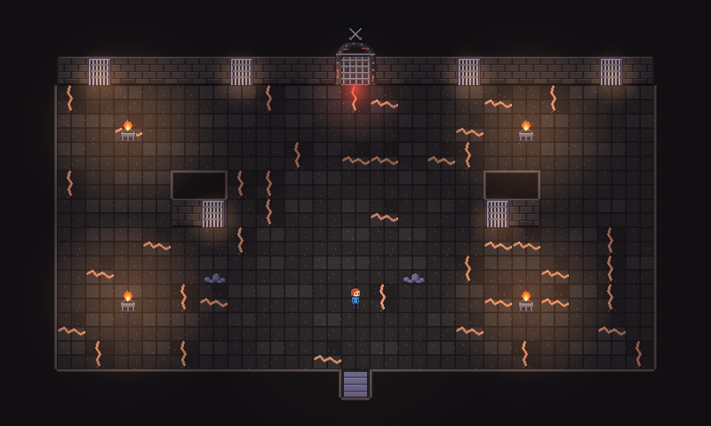

- **Biom im Mockup:** Glutkammer
- **Fantasie:** Eine Kampfgrube mit vier Gittertoren in der Nordwand und zwei in kurzen Innenmauern; vier Feuerschalen markieren den Ring.
- **Bau:** 25×15, großer offener Ring, zwei Innenmauer-Stücke mit Toren nach Süden, Schutt als Deckung. Tore sitzen IN der Vorderseite (bündig), nicht außen im Fels.
- **Gegner-Auftritt:** Nur aus Toren: Gitter rasselt und Licht dahinter (1 s), Gitter hebt sich, Gegner tritt heraus. Jede Welle öffnet andere Tore, nie alle gleichzeitig.
- **Licht:** Feuerschalen orange, Tore glühen rot, wenn aktiv. Zwischen den Wellen flackern alle Schalen kurz hoch.
- **Tür:** Gekreuzte Schwerter, rotes Licht; Eingangstür fällt hörbar zu.
- **Intro / Aufgabenleiste:** Tür zu → Kamera zeigt die Tore (1,5 s) → Banner „Arena – 3 Wellen“ → 3-2-1 → Tore öffnen. Aufgabenleiste: „Welle 1/3 · 6 Gegner“. Zwischen Wellen 2 s Pause mit „Welle 2/3“ und Gong.
- **Belohnung:** Bonus-Truhe erscheint auf dem Podest in der Mitte.

## Geleit · „Bring den verirrten Dorfbewohner sicher zum Ausgang.“

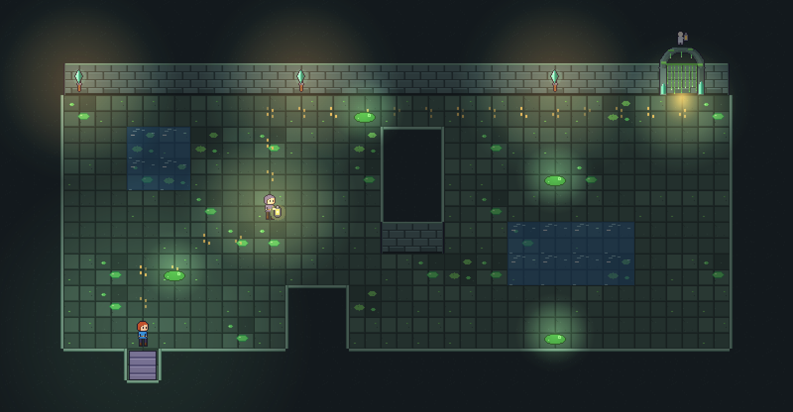

- **Biom im Mockup:** Schleimgrotte
- **Fantasie:** Ein Bewohner mit Laterne irrt durch die Grotte; sein Pfad ist als Leuchtmarken auf dem Boden sichtbar und führt an Wasserbecken vorbei zum Tor oben rechts.
- **Bau:** 25×13, Eingang unten links, Ausgang oben rechts, Weg als S-Kurve um Wasser (verlangsamt) und zwei Mauern. Pfützen als Quellen flankieren den Weg.
- **Gegner-Auftritt:** Pfützen blubbern am Pfad, Schleime springen heraus und zielen auf die Figur.
- **Licht:** Die Laterne der Figur ist die wärmste Lichtquelle; der Pfad pulsiert gelb. Umgebung 50 %.
- **Tür:** Laternen-Figur-Symbol, warmes gelbes Licht.
- **Intro / Aufgabenleiste:** Kamera auf die Figur (sie winkt, lost_villager_scared), Banner „Bring ihn zum Ausgang“, Pfad leuchtet auf, Countdown. Leiste: Figuren-Herzen + Fortschritt 0–100 % entlang des Pfads.
- **Belohnung:** Bonus-Truhe; der Gerettete erscheint im Dorf (Chronik). Vorschlag Gameplay: Figur bleibt stehen, wenn ein Gegner < 3 Kacheln nah ist, und ruft („Hilfe!“-Blase); läuft 1,2× schneller, wenn der Spieler neben ihr geht.
- **Geleit-Figur:** Verirrter Dorfbewohner (lost_villager): Kapuzenumhang, kleine Laterne, Umhangfarbe variiert per Modulate. Selten (5 %) ein Huhn mit Laterne am Hals als Überraschung. Alternative für später: ein Kind mit Kerze (höhere Dringlichkeit) oder ein verletzter Wächter, der sich schleppt (langsamer, dafür schlägt er zurück).

## Flamme hüten · „Halte die Seelenflamme 40 s am Leben.“

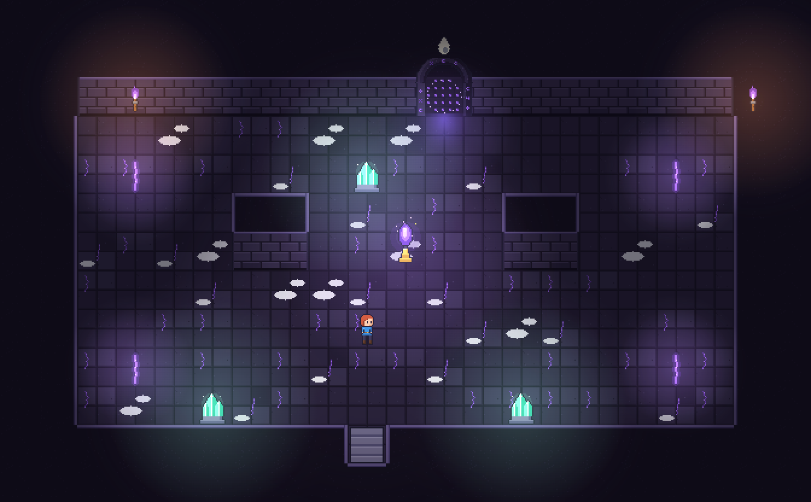

- **Biom im Mockup:** Schattenreich
- **Fantasie:** Ein Schrein: die Flamme steht auf einem Podest zwischen zwei Mauerstümpfen, drei Lichtkristalle im Raum, vier Bodenrisse in den Ecken.
- **Bau:** 21×13, symmetrisch, Flamme in der Mitte, Deckung links und rechts, Risse in den vier Ecken (Gegner kommen aus allen Richtungen).
- **Gegner-Auftritt:** Bodenrisse leuchten violett, Gestalten ziehen sich hoch; Schübe alle 8 s, pro Schub andere Ecke.
- **Licht:** Flamme blau-violett, hell; wird dunkler, wenn ihre HP sinken (Lichtradius = HP). Kristalle türkis als Orientierung.
- **Tür:** Flammen-Symbol, bläuliches Licht.
- **Intro / Aufgabenleiste:** Kamera schwenkt auf die Flamme, Banner „Halte die Flamme 40 s“, Countdown. Leiste: Flammen-HP-Balken + Zeit 0:40.
- **Belohnung:** Bonus-Truhe; Flamme unversehrt = +1 Kristall.

## Reliquie holen · „Hol die Reliquie und bring sie zum Altar.“

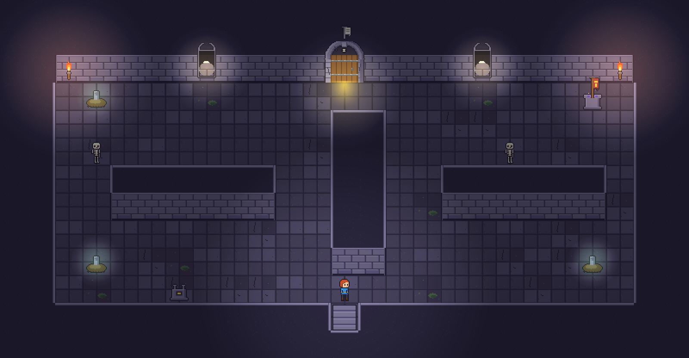

- **Biom im Mockup:** Krypta
- **Fantasie:** Zwei Gänge um eine Mittelmauer führen zur Reliquie (Banner) hinten rechts; der leere Altar steht neben dem Eingang.
- **Bau:** 25×13, Mittelmauer teilt den Raum in Hin- und Rückweg; zwei lange Innenmauern bilden Korridore; Gräber hinter dem Spieler.
- **Gegner-Auftritt:** Erst beim Aufnehmen der Reliquie brechen alle Gräber auf (Signal), Skelette jagen den Träger auf dem Rückweg.
- **Licht:** Reliquie leuchtet gold, Altar hat eine leere, dunkle Mulde, die beim Ablegen aufleuchtet.
- **Tür:** Banner-Symbol, goldenes Licht.
- **Intro / Aufgabenleiste:** Kamera fährt vom Altar zur Reliquie, Banner „Hol die Reliquie“, Countdown. Leiste: „Reliquie 0/1“, Träger-Icon wenn getragen.
- **Belohnung:** Bonus-Truhe. Ab Zyklus 6 zwei Reliquien.

## Seelen sammeln · „Sammle 12 Seelen, bevor sie verlöschen.“

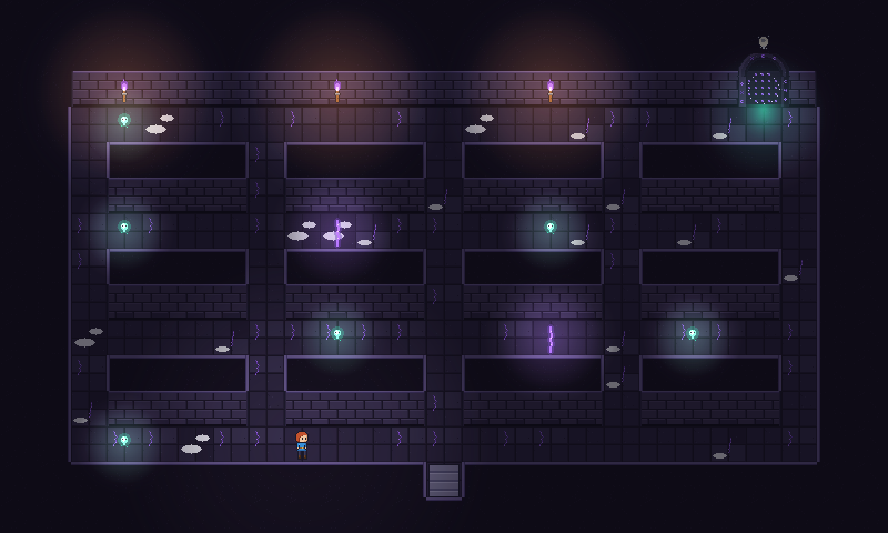

- **Biom im Mockup:** Schattenreich
- **Fantasie:** Ein Katakomben-Raster aus Mauerblöcken; Seelenlichter tauchen nacheinander in den Gassen auf.
- **Bau:** 25×15, Labyrinth aus 4×2-Blöcken mit 1-Kachel-Gassen, Risse in zwei Kreuzungen. Seelen erscheinen an 12 festen Plätzen in zufälliger Folge.
- **Gegner-Auftritt:** Risse spucken Schattenwesen, wenn der Spieler eine Seele nimmt (Takt).
- **Licht:** Dunkel; jede Seele ist eine kleine türkise Lichtinsel, dadurch sieht man das Labyrinth stückweise.
- **Tür:** Seelen-Symbol, türkises Licht.
- **Intro / Aufgabenleiste:** Kamera zeigt drei Seelen aufflackern, Banner „Sammle 12 Seelen“, Countdown. Leiste: „Seelen 0/12 · 0:45“.
- **Belohnung:** Kristalle nach Anzahl.

## Risse schließen · „Zerstöre die Risse, aus denen Gegner kommen.“

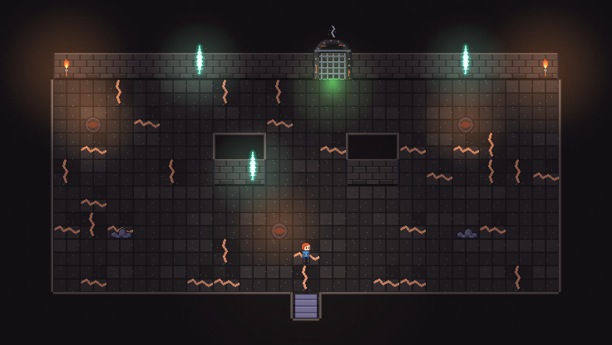

- **Biom im Mockup:** Glutkammer
- **Fantasie:** Drei Beschwörungsrisse in den Wänden (zwei außen, einer in einer Innenmauer), Lavaspalten im Boden als Begleitquellen.
- **Bau:** 23×13, Risse so verteilt, dass man zwischen ihnen wechseln muss; Schutt als Deckung vor den Vents.
- **Gegner-Auftritt:** Risse pulsieren und werfen Gegner im Takt (alle 6 s); Vents verstärken nach dem ersten zerstörten Riss.
- **Licht:** Risse türkis-weiß (biomneutral, eingefärbt), Vents orange.
- **Tür:** Riss-Symbol, grünes Licht.
- **Intro / Aufgabenleiste:** Kamera zeigt alle drei Risse, Banner „Schließe die Risse“, Countdown. Leiste: drei Riss-Icons mit HP-Balken.
- **Belohnung:** Bonus-Truhe; alle unter 40 s = Kristall.

## Jagd · „Fang den Gekrönten, bevor er entkommt.“

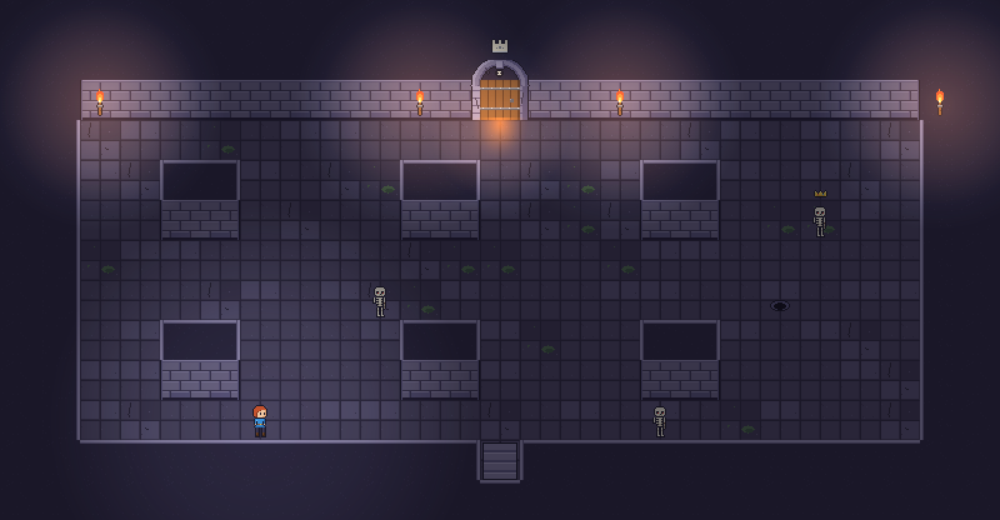

- **Biom im Mockup:** Krypta
- **Fantasie:** Eine Säulenhalle mit Sichtblockern; der Gekrönte flieht im Zickzack zu einem Fluchtloch, das sich langsam öffnet.
- **Bau:** 25×13, 2×2-Pfeiler im Raster, Fluchtloch hinten rechts, Wachen zwischen den Pfeilern.
- **Gegner-Auftritt:** Wachen stehen schon da (Skelette), stellen sich in den Weg; keine Quellen.
- **Licht:** Krone des Gekrönten leuchtet gold durch die Dunkelheit (Light2D), Fluchtloch glimmt braun und wird heller je offener.
- **Tür:** Kronen-Symbol, orange-goldenes Licht.
- **Intro / Aufgabenleiste:** Kamera auf den Gekrönten (er lacht, Krone wippt), Banner „Fang den Gekrönten“, Countdown. Leiste: Fluchtloch-Fortschritt 0–100 % + Abstand.
- **Belohnung:** Seine Beute: viel Gold, selten ein Upgrade.

## Lichtfeuer · „Entzünde alle Feuer – im Dunkeln sind die Wächter unbesiegbar.“

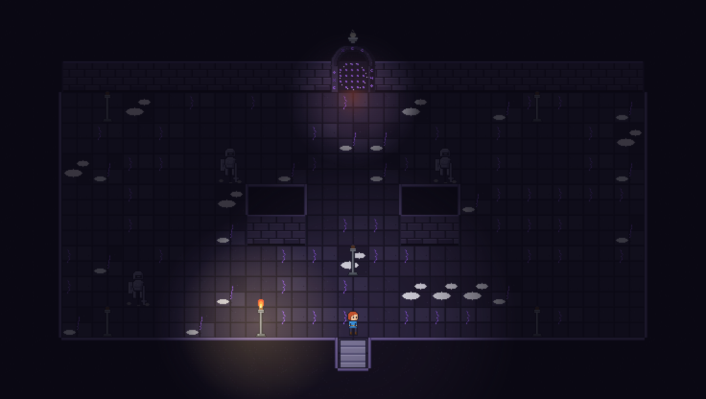

- **Biom im Mockup:** Schattenreich
- **Fantasie:** Eine fast schwarze Halle mit einem brennenden und fünf kalten Fackelständern; Steinwächter stehen reglos im Dunkeln.
- **Bau:** 23×13, Ständer in den Ecken und der Mitte, zwei Mauerstümpfe schaffen Schatten, in denen Wächter lauern.
- **Gegner-Auftritt:** Wächter sind da, bewegen sich nur außerhalb des Lichts (Augen glühen), erstarren im Licht.
- **Licht:** Umgebung 80 % dunkel; jedes entzündete Feuer schlägt eine warme Insel (Radius 4 Kacheln). Der Raum wird mit jedem Feuer lesbarer.
- **Tür:** Feuerschalen-Symbol, fast dunkler Spalt mit einem Glutpunkt.
- **Intro / Aufgabenleiste:** Kamera zeigt die kalten Ständer als Silhouetten, Banner „Entzünde alle Feuer“, Countdown. Leiste: „Feuer 1/6“ + Wächter-Icons (grau = unverwundbar, hell = verwundbar).
- **Belohnung:** Bonus-Truhe.

## Einsturz · „Überlebe 30 s, während der Boden einbricht.“

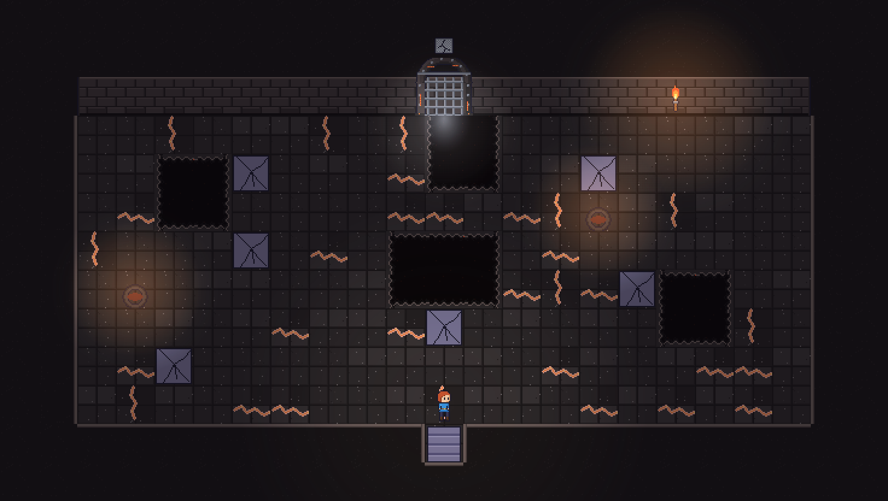

- **Biom im Mockup:** Glutkammer
- **Fantasie:** Eine Halle über einer Lavakammer: erste Felder sind schon eingebrochen, weitere bekommen Risse.
- **Bau:** 23×13, Einbruchfelder in fester Reihenfolge von außen nach innen, so dass am Ende ein Restweg zum Tor bleibt; Vents rücken Gegner nach.
- **Gegner-Auftritt:** Lavaspalten; Gegner fallen mit, wenn ihr Feld bricht (Komik + Taktik: stoßen).
- **Licht:** Risse im Boden glühen 1 s rot, bevor das Feld fällt; Löcher zeigen Glut darunter (abyss_cliff ember).
- **Tür:** Riss-im-Boden-Symbol, graues Licht.
- **Intro / Aufgabenleiste:** Kamera zeigt das erste Feld brechen, Banner „Der Boden bricht – überlebe 30 s“, Countdown. Leiste: Zeit + Mini-Karte der nächsten 3 Felder.
- **Belohnung:** Bonus-Truhe am Ende des Restwegs.

## Boss · „Thronsaal: Boss mit zwei Phasen.“

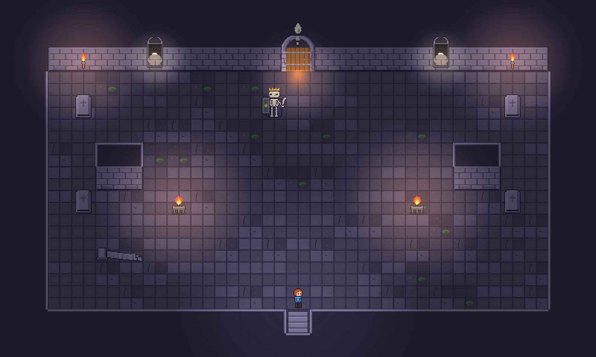

- **Biom im Mockup:** Krypta
- **Fantasie:** Ein Thronsaal: Boss vor dem Tor, Sarkophage an den Wänden (Phase 2 öffnet sie), Feuerschalen, eine gestürzte Säule.
- **Bau:** 25×15, breiter als hoch, zwei Mauerstümpfe als Deckung gegen den Schildstoß. Je Biom anderer Grundriss (Grotte: Becken in der Mitte; Schattenreich: Säulenkreis; Glutkammer: Lavagraben mit Brücke).
- **Gegner-Auftritt:** Boss-Intro wie bisher; Phase 2: Sarkophage öffnen sich (spawn_sarcophagus).
- **Licht:** Feuerschalen + Boss-Aura; Umgebung 45 %, damit der Boss immer sichtbar ist.
- **Tür:** Bosstor 64×56 mit Ketten; Ausgang zum Lagerfeuer mit Flammen-Symbol.
- **Intro / Aufgabenleiste:** Letterbox-Intro ohne HUD-Kollision (Bossleiste erscheint erst nach dem Intro).
- **Belohnung:** Seelenkristalle, Lagerfeuer.

## Lagerfeuer · „Rast: heilen oder ein Upgrade stärken.“

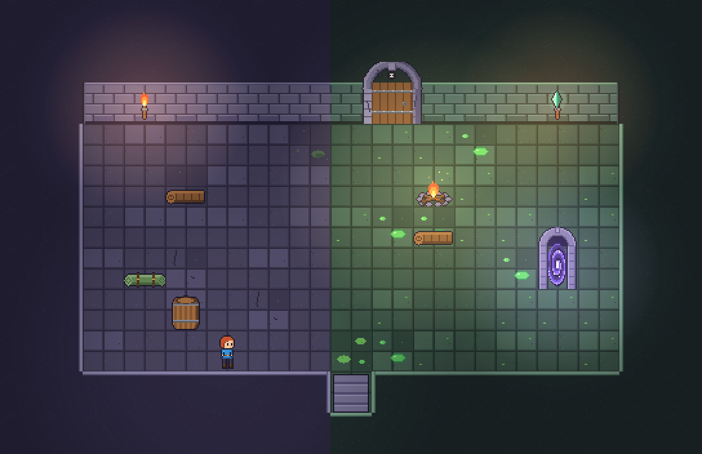

- **Biom im Mockup:** Krypta → Grotte
- **Fantasie:** Kleiner Raum, links noch Krypta-Platten, rechts schon Grottenboden; Feuer, zwei Stämme, Schlafmatte, Portal.
- **Bau:** 17×11, Übergang als harte Kante in der Raummitte (plus transition_overlay), Portal rechts hinten.
- **Gegner-Auftritt:** Keine Gegner.
- **Licht:** Feuer warm, Portal violett, Umgebung 35 %.
- **Tür:** Flammen-Symbol am Ausgang des Bossraums.
- **Intro / Aufgabenleiste:** Kein Banner; Dialog erst beim Setzen ans Feuer (E).
- **Belohnung:** Heilen, Upgrade stärken, Portal ins Dorf.

## Ruhe-Räume · „Händler, Waffenkammer, Brunnen, Altar/Pakt, Prüfung.“

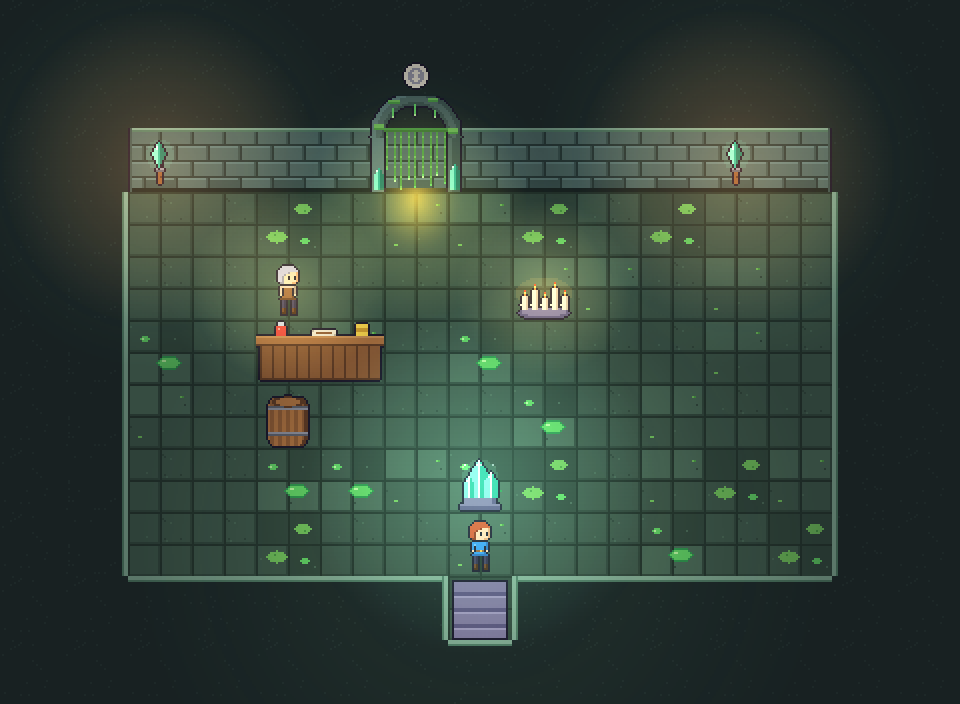

- **Biom im Mockup:** Schleimgrotte
- **Fantasie:** Keine leeren Rechtecke mehr: Händlerstube mit Theke, Kisten, Kerzen und Kristall; Waffenkammer als Waffenständer-Nische; Brunnen als Grotte mit Wasser; Altar als Apsis.
- **Bau:** 15×11 kompakt, Objekt in Sichtachse zur Tür, Deko-Gruppe um das Objekt.
- **Gegner-Auftritt:** Keine Gegner.
- **Licht:** Hell (30 %), warmes Licht beim Händler, türkis beim Brunnen, violett beim Pakt.
- **Tür:** Spezialraum-Symbol (vorhanden), goldenes Licht.
- **Intro / Aufgabenleiste:** Kurzes Banner mit Raumname (ohne Countdown).
- **Belohnung:** wie bisher.
