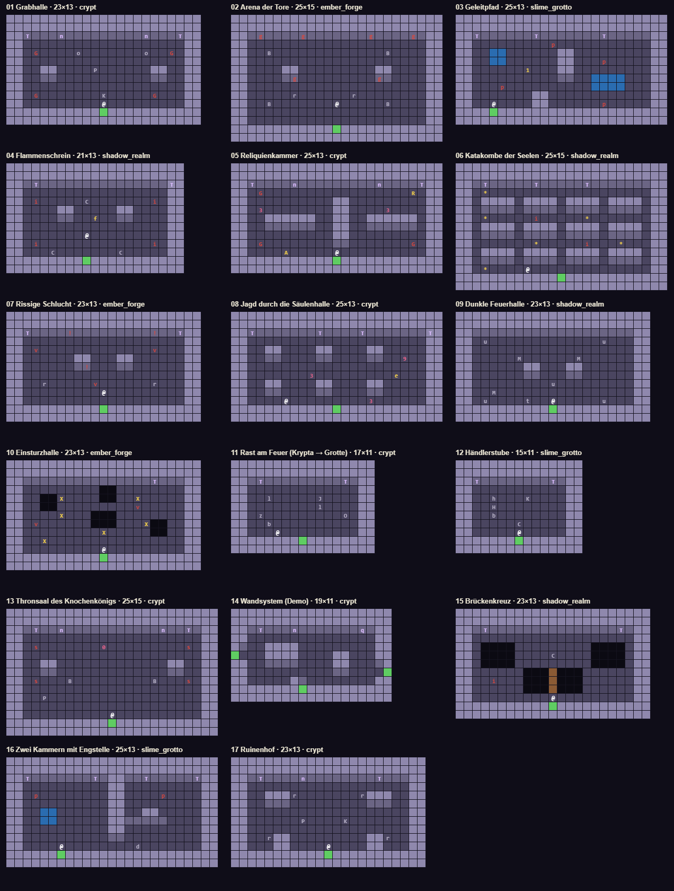

# Grundrisse (17) und Deko mit Absicht



Raster 32 px, Mauerregel: Mauermassen mit Boden im Süden sind ≥ 2 Kacheln hoch (Krone + Vorderseite); Nordwand 2 Kronen + 1 Vorderseite. Pläne maschinenlesbar in `tools/roomgen/plans.json`.

## Legende

| Zeichen | Bedeutung |
| --- | --- |
| `0` | Boss |
| `1` | Geleit-Figur |
| `2` | Schleim |
| `3` | Skelett |
| `4` | Bogenschütze |
| `5` | Schattenwesen |
| `6` | Golem |
| `9` | Gekrönter (Jagd) |
| `.` | Boden |
| `#` | Mauer (Krone; Vorderseite automatisch, wo Süden Boden ist) |
| `x` | außerhalb |
| `~` | Abgrund |
| `=` | Brücke |
| `w` | seichtes Wasser / Schlamm |
| `S` | Eingang Süd (Treppe) |
| `N` | Tür Nord (Torbogen, Symbol + Lichtfarbe des Modus) |
| `W` | Seitentür West |
| `E` | Seitentür Ost |
| `T` | Wandfackel |
| `n` | Wandnische |
| `q` | rissige Geheimwand |
| `g` | Gittertor (Arena-Quelle) |
| `!` | Beschwörungsriss in der Wand |
| `G` | Grab (Quelle Krypta) |
| `s` | Sarkophag (Quelle Elite/Boss) |
| `p` | Pfütze (Quelle Grotte) |
| `i` | Bodenriss (Quelle Schattenreich) |
| `v` | Lavaspalte (Quelle Glutkammer) |
| `C` | Lichtkristall |
| `B` | Feuerschale |
| `t` | Fackelständer brennend |
| `u` | Fackelständer aus |
| `f` | Seelenflamme |
| `A` | Reliquien-Altar |
| `R` | Reliquie |
| `*` | Seele |
| `e` | Fluchtloch |
| `X` | Einbruchfeld (Warnung) |
| `c` | Truhe |
| `r` | Schutt |
| `b` | Fass |
| `k` | Knochen |
| `o` | Sarg |
| `P` | eingestürzte Säule (2 Kacheln) |
| `K` | Opferstelle (Kerzen) |
| `d` | Tropfstelle |
| `H` | Händlertheke (2 Kacheln) |
| `h` | Händler |
| `Q` | Brunnen |
| `U` | Upgrade-Altar |
| `Y` | Pakt-Altar |
| `V` | Wagnis-Altar |
| `J` | Lagerfeuer |
| `l` | Baumstamm |
| `z` | Schlafmatte |
| `O` | Ausgangsportal |
| `M` | Steinwächter |
| `+` | Stachelfalle |
| `&` | Treppe |
| `@` | Spieler |

## Pläne

### 01_saeubern_grabhalle · Grabhalle (23×13, crypt, Modus saeubern)

```
#######################
#######################
##T###n####N####n###T##
##...................##
##.G....o.......o..G.##
##...................##
##..##....P......##..##
##..##...........##..##
##...................##
##.G.......K.....G...##
##.........@.........##
###########S###########
#######################
```

### 02_arena_tore · Arena der Tore (25×15, ember_forge, Modus arena)

```
#########################
#########################
###g####g###N###g####g###
##.....................##
##..B.............B....##
##.....................##
##....##.........##....##
##....#g.........g#....##
##.....................##
##.....r......r........##
##..B.......@.....B....##
##.....................##
##.....................##
############S############
#########################
```

### 03_geleit_pfad · Geleitpfad (25×13, slime_grotto, Modus geleit)

```
#########################
#########################
##T######T#######T###N###
##.........p...........##
##..ww......##.........##
##..ww......##...p.....##
##......1...##.........##
##..........##..wwww...##
##...p..........wwww...##
##.......##............##
##..@....##......p.....##
####S####################
#########################
```

### 04_flamme_schrein · Flammenschrein (21×13, shadow_realm, Modus flamme)

```
#####################
#####################
###T#######N#######T#
##.................##
##.i.....C.......i.##
##....##.....##....##
##....##..f..##....##
##.................##
##.......@.........##
##.i.............i.##
##...C.......C.....##
#########S###########
#####################
```

### 05_reliquie_kammer · Reliquienkammer (25×13, crypt, Modus reliquie)

```
#########################
#########################
##T####n####N####n####T##
##.G.................R.##
##..........##.........##
##.3........##....3....##
##..######..##..######.##
##..######..##..######.##
##..........##.........##
##.G........##.......G.##
##....A.....@..........##
############S############
#########################
```

### 06_seelen_katakombe · Katakombe der Seelen (25×15, shadow_realm, Modus seelen)

```
#########################
#########################
###T#####T#####T#####N###
##.*...................##
##.####.####.####.####.##
##.####.####.####.####.##
##.*.....i.....*.......##
##.####.####.####.####.##
##.####.####.####.####.##
##.......*.....i...*...##
##.####.####.####.####.##
##.####.####.####.####.##
##.*....@..............##
############S############
#########################
```

### 07_risse_schlucht · Rissige Schlucht (23×13, ember_forge, Modus risse)

```
#######################
#######################
##T####!####N####!##T##
##...................##
##.v.............v...##
##......##...##......##
##......#!...##......##
##...................##
##..r.....v......r...##
##.........@.........##
##...................##
###########S###########
#######################
```

### 08_jagd_saeulenhalle · Jagd durch die Säulenhalle (25×13, crypt, Modus jagd)

```
#########################
#########################
##T#######T#N##T#######T#
##.....................##
##..##....##....##.....##
##..##....##....##..9..##
##.....................##
##.......3.........e...##
##..##....##....##.....##
##..##....##....##.....##
##....@.........3......##
############S############
#########################
```

### 09_lichtfeuer_halle · Dunkle Feuerhalle (23×13, shadow_realm, Modus lichtfeuer)

```
#######################
#######################
###########N###########
##.u.............u...##
##...................##
##.....M......M......##
##......##...##......##
##......##...##......##
##.........u.........##
##..M................##
##.u....t..@.....u...##
###########S###########
#######################
```

### 10_einsturz_halle · Einsturzhalle (23×13, ember_forge, Modus einsturz)

```
#######################
#######################
###########N#####T#####
##.........~~........##
##..~~X....~~..X.....##
##..~~.........v.....##
##....X...~~~........##
##.v......~~~...X~~..##
##.........X.....~~..##
##..X................##
##.........@.........##
###########S###########
#######################
```

### 11_lagerfeuer_rast · Rast am Feuer (Krypta → Grotte) (17×11, crypt → slime_grotto, Modus lagerfeuer)

```
#################
#################
###T#####N###T###
##.............##
##..l.....J....##
##........l....##
##.z.........O.##
##..b..........##
##...@.........##
########S########
#################
```

### 12_haendler_stube · Händlerstube (15×11, slime_grotto, Modus ruhe_haendler)

```
###############
###############
##T###N####T###
##...........##
##..h...K....##
##..H........##
##..b........##
##.....C.....##
##.....@.....##
#######S#######
###############
```

### 13_boss_thronsaal · Thronsaal des Knochenkönigs (25×15, crypt, Modus boss)

```
#########################
#########################
###T##n#####N#####n##T###
##.....................##
##.s.......0.........s.##
##.....................##
##..##.............##..##
##..##.............##..##
##.s...B.........B...s.##
##.....................##
##..P..................##
##.....................##
##..........@..........##
############S############
#########################
```

### 14_wandsystem_demo · Wandsystem (Demo) (19×11, crypt, Modus saeubern)

```
###################
###################
###T###n####N##q###
##...............##
##..####.........##
W...####....##...##
##..####....##...##
##..........##....E
##.....##........##
########S##########
###################
```

Demo des Wand-Systems: dicke Mauer (nur Außenkanten), 2×2-Pfeiler, Stumpf an der Südwand, Nische und rissige Wand bündig in der Vorderseite, Seitentüren im Gang.

### 15_brueckenkreuz · Brückenkreuz (23×13, shadow_realm, Modus saeubern)

```
#######################
#######################
###T#######N#######T###
##...................##
##.~~~~.........~~~~.##
##.~~~~....C....~~~~.##
##.~~~~.........~~~~.##
##......~~~=~~~......##
##..i...~~~=~~~......##
##......~~~=~~~......##
##.........@.........##
###########S###########
#######################
```

Abgrund als Bauteil: zwei Gruben und eine Hängebrücke; Kante zum Hineinstoßen, Kristall als Ziel.

### 16_zwei_kammern · Zwei Kammern mit Engstelle (25×13, slime_grotto, Modus saeubern)

```
#########################
#########################
##T#######T#N###T#####T##
##..........##.........##
##.p........##....p....##
##..........##.........##
##..ww......##..##.....##
##..ww......#######....##
##..........##.........##
##..........##.........##
##....@........d.......##
######S##################
#########################
```

Zwei Kammern, eine Engstelle unten; Wasser verlangsamt die linke Kammer; Tropfstelle über dem Durchgang.

### 17_ruinenhof · Ruinenhof (23×13, crypt, Modus saeubern)

```
#######################
#######################
###T####n###N####T#####
##...................##
##..###r.......r###..##
##..###.........###..##
##...................##
##......P....K.......##
##...................##
##..r##.........##r..##
##...##....@....##...##
###########S###########
#######################
```

Ruinen: Mauerreste mit Schutt am Ende, gestürzte Säule, Opferstelle. Deko-Gruppen statt Streuung.

## Deko mit Absicht

- Eingestürzte Säule: pillar_fallen + 2× rubble im Fächer in Fallrichtung + Staub (Partikel).
- Opferstelle: candles_cluster + bones_1 + 1 Grabstein (spawn_grave Frame 1) – wird gern zur Quelle.
- Tropfende Decke: drip_4f über toxic_puddle/shallow_water, Moosrand (floor_4) ringsum.
- Lagerplatz: crate + barrel + bedroll nebeneinander an einer Wand, Fackel darüber.
- Wachposten: torch_stand + rubble_2 + bones_2 an einer Engstelle.
- Regeln: Gruppen an Wänden und Ecken, nie im einzigen Gang; Fallen nur mit sichtbarem Grund (vor einer Truhe, in einem Nebengang); max. 1 Gruppe pro 20 Bodenkacheln.
