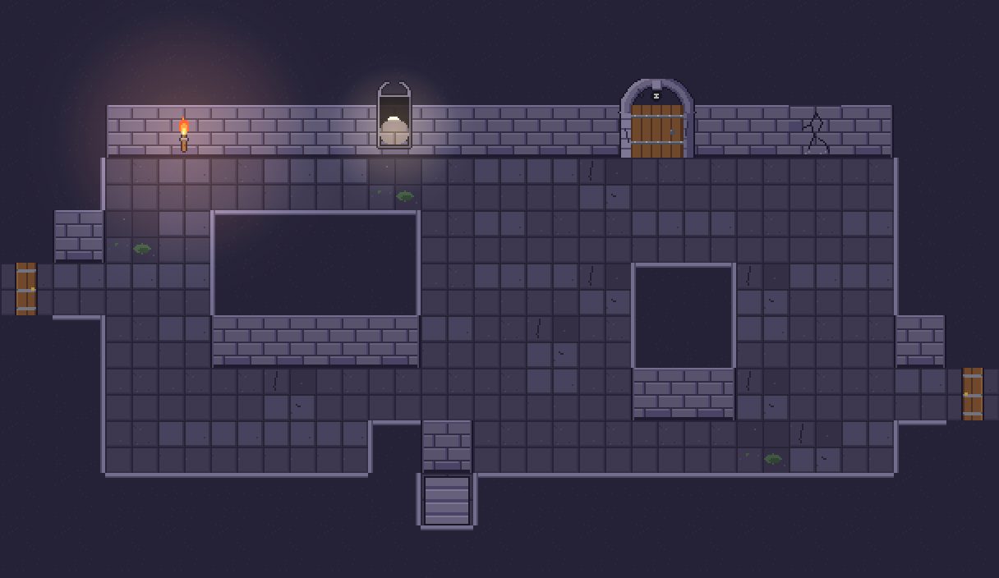

# Wand-System

- Ein Autotile pro Biom (wall_autotile_<biom>.png): 16 Kronen nach Nachbarmaske + 4 Vorderseiten; Innenecken separat. Außen- und Innenmauern aus demselben Set, dadurch überall 3/4-Sicht.
- Regel: Mauermassen, die nach Süden an Boden grenzen, sind mindestens 2 Kacheln hoch (Krone + Vorderseite). Pfeiler = 2×2 (oder 1×2). Nordwand = 2 Kronen + 1 Vorderseite, damit Torbögen (48 px) nicht oben abgeschnitten werden.
- Einbauten sitzen in der Vorderseiten-Kachel: Fackel, Nische (wall_niche 32×48 reicht in die Krone), rissige Wand (wall_cracked ersetzt die Vorderseite), Gittertor, Beschwörungsriss, Torbogen (Rahmen überlappt Vorderseite + Krone).
- Geheimnische: hinter der rissigen Vorderseite liegt eine 1×3-Nische, die vor dem Sprengen als Krone gezeichnet wird (kein sichtbarer Kasten im Fels).
- Seitenwände: Seitentür im waagerechten Gang (door_side_*), über dem Gang eine Reihe Vorderseite mit Fackel, Gang 1 Kachel hoch, mindestens 3 Kacheln lang, optional stairs_down für Höhenversatz.
- Abgrund: Nordkante bekommt abyss_cliff_<biom> als Felswand, Brücken aus bridge_rope_tiles; Abgrund ist Bauteil der Grundrisse (15, 10), keine Raumart.

Dateien: `art/environment/tiles/wall_autotile_<biom>.png` (4×5), `wall_inner_corner_<biom>.png`, `abyss_cliff_<biom>.png`, `art/environment/deco/wall_niche.png`, `art/environment/rooms/wall_cracked_<biom>.png`.
