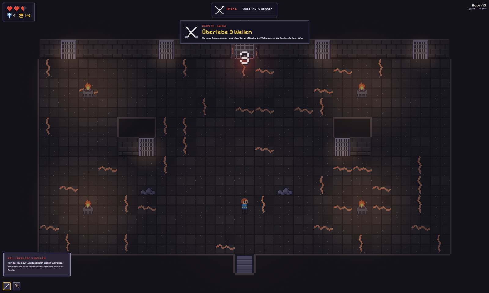
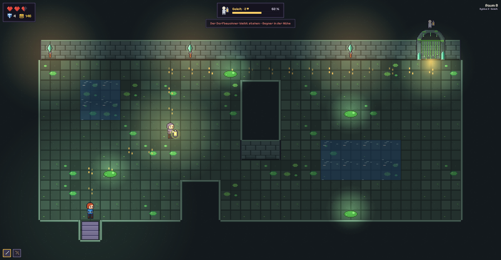
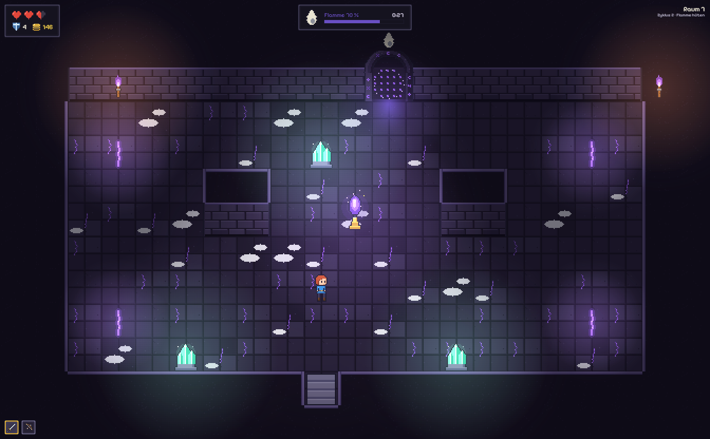

# UI-Rework: Intro-Muster, Aufgabenleiste, HUD

- Intro-Muster (alle Modi): Tür zu (0,3 s) → Kamera auf das Ziel (1,5 s) → Ziel-Banner oben Mitte mit Modus-Symbol in Modusfarbe, großer Satz, kleine Zeile mit Regel → 3-2-1 als große Zahl in der Mitte mit Tick → los. Beim ersten Mal zusätzlich Erklärkarte links (wie Katakombe), die beim Countdown ausblendet.
- Aufgabenleiste oben Mitte unter dem Banner-Platz: Modus-Symbol + Fortschritt (Balken oder x/y) + Zeit. Gefahr-Zustand (Flamme < 30 %, Figur steht) färbt die Leiste rot und pulsiert.
- HUD-Rework: Herzen/Schild/Gold links oben in panel_dark bleiben; Raum/Zyklus-Zeile rechts oben wandert in dieselbe Höhe wie die Aufgabenleiste und weicht der Bossleiste (Bossleiste ersetzt die Aufgabenleiste). Weltbeschriftungen („Brunnen“) nur bei Nähe und nie gleichzeitig mit einem Banner.
- Dialoge (Upgrade, Händler, Lagerfeuer): Karten mit Rahmen panel/panel_gold, Pixelify-Titel, 32-px-Icon, kurze Texte; maximal 60 % der Bildschirmhöhe, Szene bleibt sichtbar und abgedunkelt (siehe Game-UI.dc.html).
- Banner-Stil: panel_dark mit Modusfarben-Streifen links, Symbol 32 px, Titel 14 px Pixelify, Untertitel 7 px; Weltbeschriftungen und Banner teilen sich eine Warteschlange (nie zwei gleichzeitig).

Farben der Modi: Arena #e0463a · Geleit #ffd166 · Flamme #6a4fc4 · Reliquie #f2cf4a · Seelen #2fb391 · Risse #5fcd62 · Jagd #ff8a3c · Lichtfeuer #5a2a22 · Einsturz #8c8f9a · Elite #a66ef0. Panels: panel_dark (HUD, Leiste, Banner), panel (Erklärkarte), Modusfarbe als 4–6 px Streifen links.
