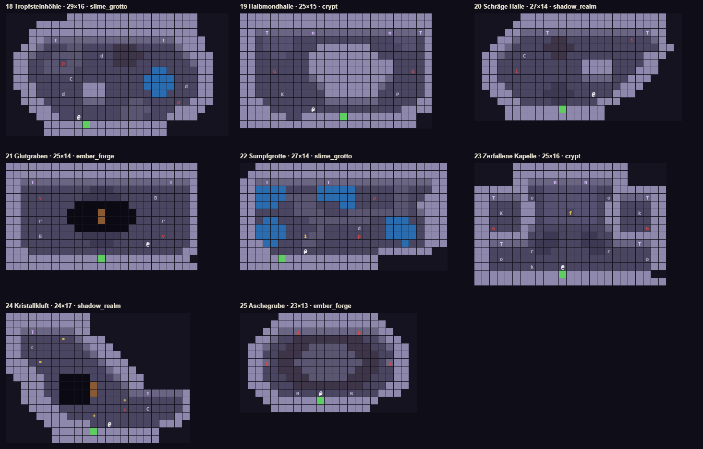
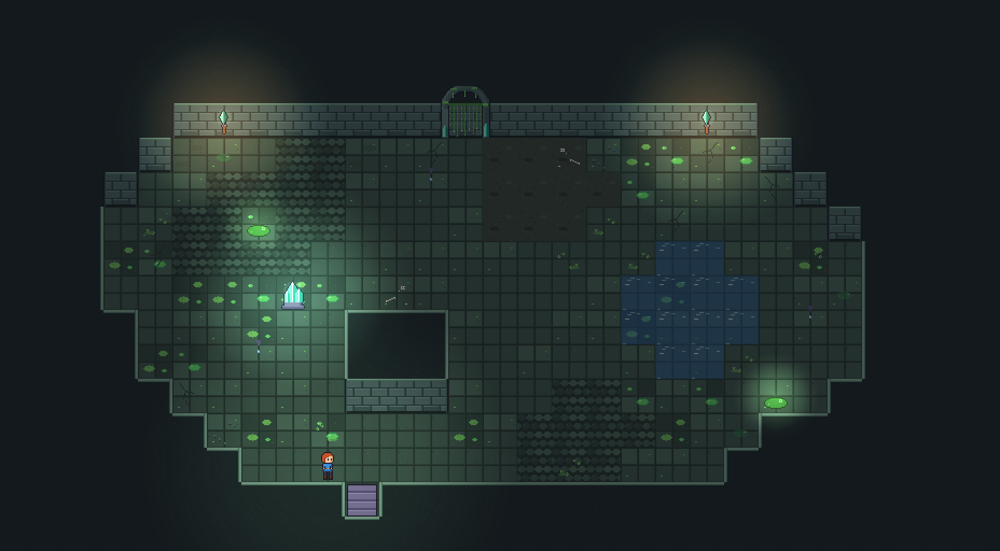
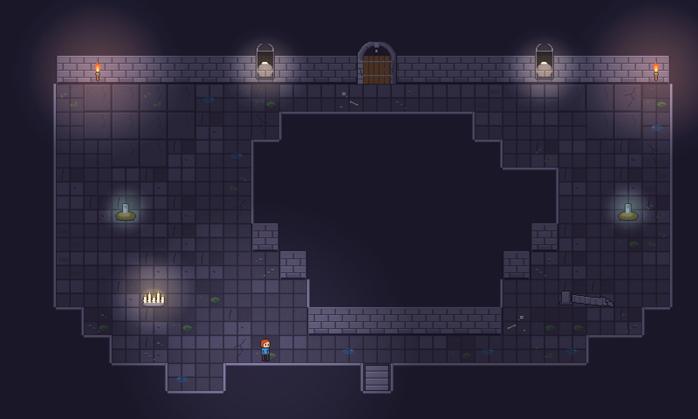
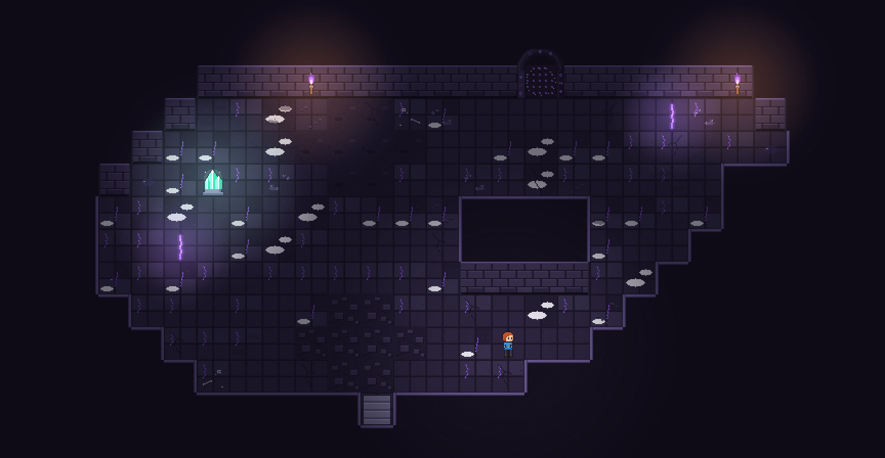
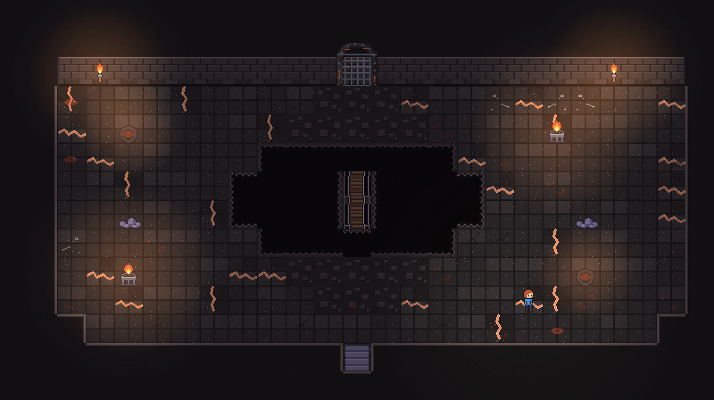
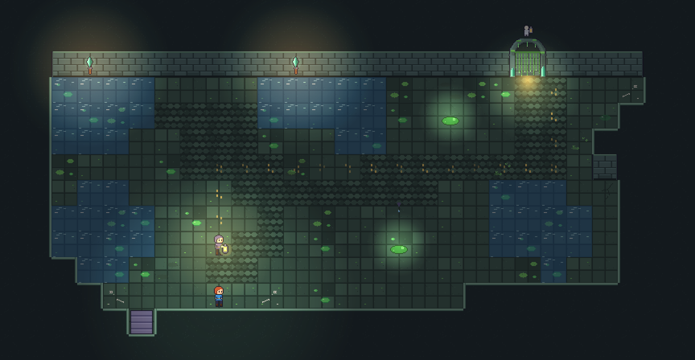
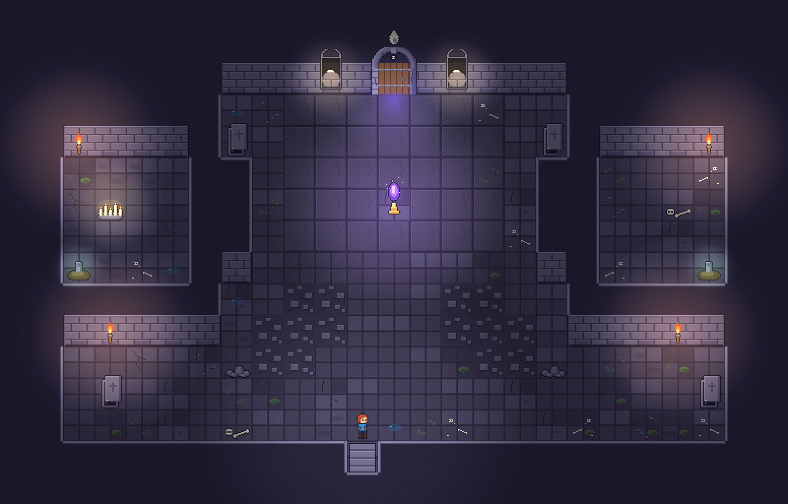
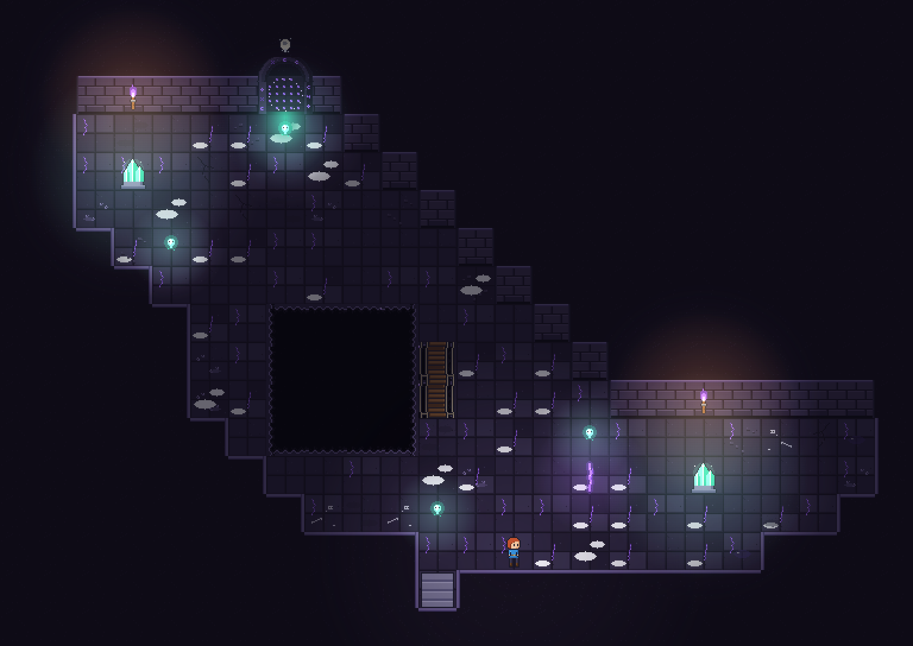
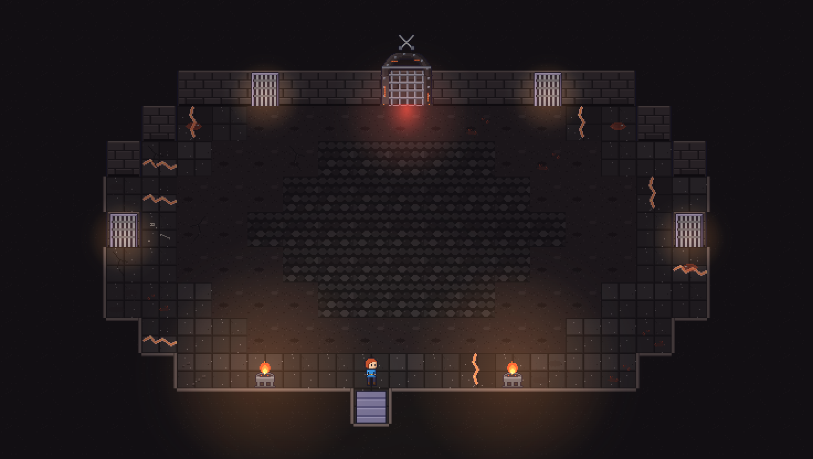

# Makeover 2 – organische Räume

Makeover 2: Räume werden aus dem Fels geschnitten statt als Kasten gebaut. Vier Hebel: Umriss, Bodenzonen, Streu-Overlays, Nischen. Alles mit den vorhandenen Vorlagen-Mechaniken (TileMap + Autotile) baubar; die acht Pläne hier sind direkt als Vorlagen nutzbar (tools/roomgen/plans2.json).



## Hebel

### Umriss aus dem Fels

Der Raum ist ein Loch im Fels: außen überall Krone (m15), der Innenumriss in Stufen von 1–2 Kacheln (Diagonalen, Bäuche, Buchten). Regel bleibt: Mauer mit Boden im Süden ≥ 2 hoch. Kein Grundriss ist mehr ein reines Rechteck; die Tür sitzt nicht immer mittig.

### Bodenzonen

Vier Zusatzböden je Biom (floor_extra_<biom>: große Platten, Kopfstein, Erde, Geröll) in Flecken von 4–12 Kacheln mit ausgefransten Rändern. Platten = Prozessionsweg/Mitte, Kopfstein = alte Pfade, Erde = Ränder und Buchten, Geröll = unter eingestürzten Stellen. Wasser und Schlamm als eigene Zonen (verlangsamen).

### Streu-Overlays

overlay_<biom> (Riss, Kiesel, Büschel, Knochen, Pfütze, Staub): 30–50 % an Wänden und in Ecken, 5–8 % in der Fläche, nie unter Objekten, zufällig gespiegelt. Das nimmt die Sterilität ohne Kollision oder Gameplay-Kosten.

### Nischen und Buchten

Seitenkapellen, Alkoven, Felsvorsprünge: 2–4 Kacheln große Taschen im Umriss, in denen Deko-Gruppen, Quellen oder Truhen liegen. Gibt Rhythmus (eng → weit → eng) und Blickziele.

### Bewegung im Bild

Statisch wirkt steril: Tropfstellen, Fackeln, Kristall-Puls, Nebelfetzen am Boden (abyss_mist), Staubpartikel im Lichtkegel, Wasser-Glitzern. Jeder Raum bekommt 2–3 bewegte Deko-Punkte, auch ohne Gegner.

### Licht formt den Raum

Umgebung 45–55 % statt schwarz; Lichtinseln ungleich verteilt (eine helle Seite, eine dunkle), Tür-Lichtkegel in Modusfarbe, Quellen glimmen. Sichtlinien führen zum Ziel.

## Die acht Pläne

- **18 Tropfsteinhöhle** – Grotte als unregelmäßiger Blob mit Bauch links, Wasserbecken rechts, Kopfstein-Pfad, Erde-Fleck, zwei Tropfstellen, Kristall als Lichtinsel, Felsblock in der Mitte.
- **19 Halbmondhalle** – Krypta: Hauptweg als Halbmond um einen massiven Felskern; Platten-Zonen in den Ecken, Gräber in den Hörnern, Opferstelle und gestürzte Säule im Süden.
- **20 Schräge Halle** – Schattenreich: Parallelogramm mit Treppen-Diagonalen; Erde-Zone oben, Geröll unten, Felsblock als Sichtblocker, Risse in den spitzen Ecken.
- **21 Glutgraben** – Glutkammer: Lavagraben quer durch den Raum mit Brücke in der Mitte, Geröllränder, Vents diagonal versetzt, Feuerschalen asymmetrisch.
- **22 Sumpfgrotte (Geleit)** – Wasserbecken links und rechts, Kopfstein-Trittpfad als Geleitweg in S-Kurve, Pfützen als Quellen am Weg, Tür oben rechts.
- **23 Zerfallene Kapelle (Flamme hüten)** – Kreuzförmiges Schiff mit zwei Seitenkapellen (Alkoven mit eigener Wand), Platten-Mittelgang zur Flamme, Geröll vor dem Querschiff, Särge und Gräber in den Kapellen.
- **24 Kristallkluft (Seelen)** – Zwei Höhlen diagonal versetzt, verbunden durch einen Spalt mit Abgrund und Brücke; Seelen verteilt, Kristalle als Orientierungslichter.
- **25 Aschegrube (Arena)** – Achteckige Grube mit Kopfstein-Ring in der Mitte und Erde-Rand; Tore in Nord- und Seitenwänden, Feuerschalen unten.

### 18_tropfsteinhoehle (29×16, slime_grotto)



```
xxxxxxxx#################xxxx
xxxx#####################xxxx
xxx######################xxxx
xxx###T######N######T#####xxx
xx###...,,....:::.....####xxx
x###..,,,,..d.::::.....####xx
x##..,,p,,....:::.......###xx
x##..,,,,..........ww....##xx
x##.....C.........wwww...##xx
x###......###.....wwww.d.##xx
xx##...d..###......ww....##xx
xx###.....###...,,....p.###xx
xxx###.........,,,,...####xxx
xxxx###..@.....,,,...####xxxx
xxxxx#####S##########xxxxxxxx
xxxxx################xxxxxxxx
```

### 19_halbmond (25×15, crypt)



```
#########################
#########################
###T#####n###N#####n###T#
##.;;;;.............;;;.#
##.;;;;...#######....;;.#
##..;;...#########......#
##.......###########....#
##..G....###########..G.#
##.......###########....#
##........#########.....#
##...K.....#######..P...#
###........#######.....##
####.....@...........####
######..#####S#########xx
#######################xx
```

### 20_schraege_halle (27×14, shadow_realm)



```
xxxxxx###################xx
xxxxx####################xx
xxxx#####T######N#####T##xx
xxx###....::........i..##xx
xx###....::::...........##x
x###..C...::..........###xx
x##...........####....##xxx
x##..i........####...###xxx
x##...........####..###xxxx
x###......%%.......###xxxxx
xx###....%%%%..@..###xxxxxx
xxx###....%%....###xxxxxxxx
xxxx#######S#####xxxxxxxxxx
xxxx#############xxxxxxxxxx
```

### 21_glutgraben (25×14, ember_forge)



```
#########################
#########################
###T########N########T###
##.........%%%..........#
##..v.....%%%%%....B....#
##.......~~~~~~~........#
##......~~~~=~~~~.......#
##..r...~~~~=~~~~...r...#
##.......~~~~~~~........#
##..B.....%%%%%.....v...#
##.........%%%....@.....#
###....................##
############S###########x
#########################
```

### 22_sumpfgrotte (27×14, slime_grotto)



```
xx#########################
x##########################
###T#######T########N######
##wwww....wwwww.....,,...##
##wwww,,,,wwwww..p..,,..###
##www..,,,...ww.....,,.####
##.....,,,,...,,,,,,,,.####
##.ww....,,,,,,,,..www..###
##wwww....,....d...wwww.###
##wwww..1,,....p...wwww.###
###ww...,,...........w..###
####....@.........#######xx
#####S############xxxxxxxxx
##################xxxxxxxxx
```

### 23_zerfallene_kapelle (25×16, crypt)



```
xxxxx###############xxxxx
xxxxx###############xxxxx
xxxxx#####n#N#n#####xxxxx
#######..;;;;;;;..#######
##T####o.;;;;;;;.o####T##
##....##.;;;;;;;.##....##
##.K..##.;;;f;;;.##..k.##
##....##.;;;;;;;.##....##
##G...##.........##...G##
#######..%%...%%..#######
###T###.%%%...%%%.###T###
##.....r%%.....%%r.....##
##.o..................o##
##.....k...@...........##
###########S###########xx
#########################
```

### 24_kristallkluft (24×17, shadow_realm)



```
###########xxxxxxxxxxxxx
###########xxxxxxxxxxxxx
###T###N###xxxxxxxxxxxxx
##.....*.####xxxxxxxxxxx
##.C......####xxxxxxxxxx
##.........####xxxxxxxxx
###.*.......####xxxxxxxx
####.........####xxxxxxx
x####..~~~~...####xxxxxx
xx###..~~~~=...###xxxxxx
xx###..~~~~=....##T#####
xx####.~~~~....*.......#
xxx####........i..C....#
xxxx####...*..........##
xxxxx######..@......###x
xxxxxx#####S########xxxx
xxxxxx##############xxxx
```

### 25_aschegrube (23×13, ember_forge)



```
xxxxx#############xxxxx
xxxx###############xxxx
xxx####g###N###g####xxx
xx###..:::::::::..###xx
x###..:::,,,,,:::..###x
x##..:::,,,,,,,:::..##x
x##g.::,,,,,,,,,::.g##x
x##..:::,,,,,,,:::..##x
x##...:::,,,,,:::...##x
x###...:::::::::...###x
xx###..B..@...B...###xx
xxx#######S#######xxxxx
xxxx#############xxxxxx
```

## Neue Grafiken

| Datei | Größe | Status |
| --- | --- | --- |
| art/environment/tiles/floor_extra_<biom>.png | 128×32 (slab, cobble, dirt, rubble) | GELIEFERT |
| art/environment/tiles/overlay_<biom>.png | 192×32 (crack, pebbles, tuft, bones, puddle, dust) | GELIEFERT |
| art/environment/deco/dust_motes_8f.png | 64×64 Partikel im Lichtkegel | offen |
| art/environment/deco/fog_floor_4f.png | 64×32 Nebelfetzen (abyss_mist reicht ggf.) | offen |
| art/environment/tiles/floor_edge_<biom>.png | 4×1 weiche Zonenränder (Platte→Erde) | offen, wenn Ausfransen per Einzelkacheln nicht reicht |

Legende der Zonen in den Plänen: `,` Kopfstein · `:` Erde · `;` Platten · `%` Geröll · `w` Wasser · `x` Fels.
