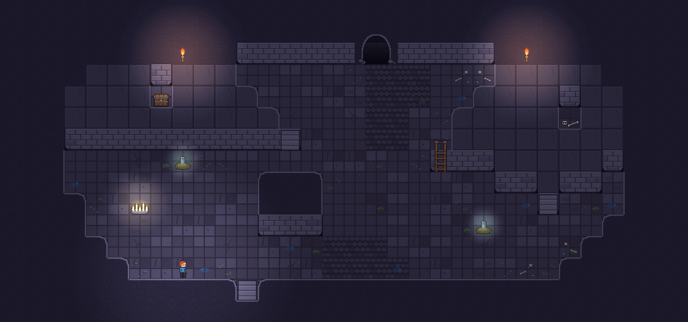
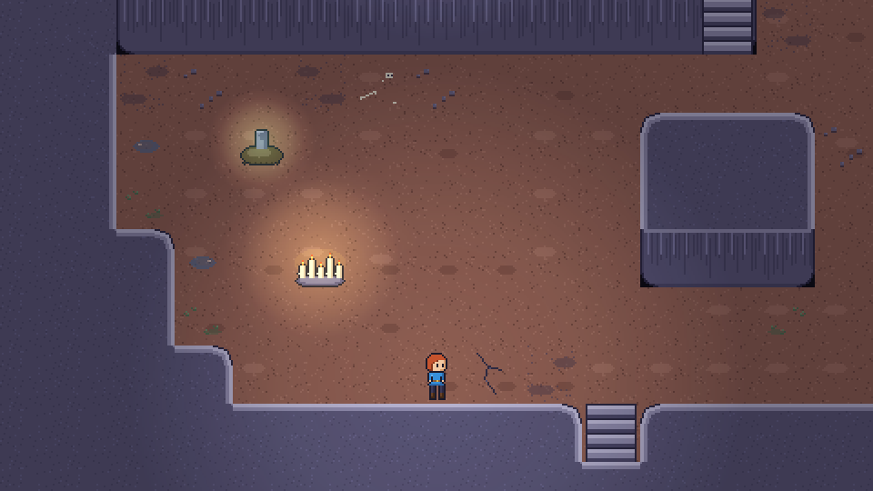
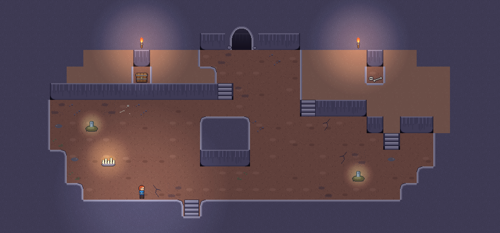
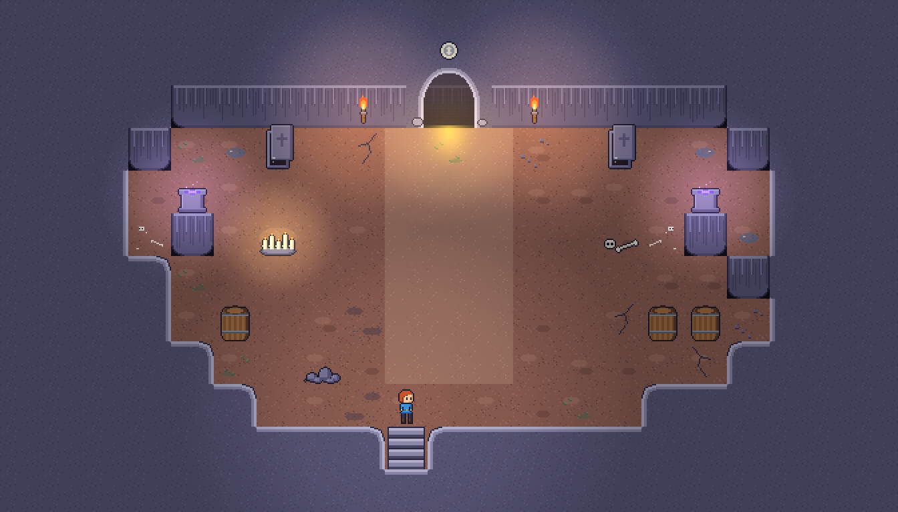

# Makeover 3 – Komplettes Raum-Makeover: runder Fels, saubere Eingänge, Höhe, Seitenansicht

Stand 14.10.2026. Antwort auf die fünf Referenzbilder (Waldlichtung, Höhlenmund, Mine mit Emporen und Leitern, Höhle mit runden Felskanten, Wasserfall in Seitenansicht). Dieses Dokument ist der Bauplan; die Mockups liegen in `mockups/26_…29_…png`, die Übergangs-Skizze in `11_uebergang_seitenansicht.png`. Die Spielmodi aus KONZEPT_RAEUME_V2 bleiben unverändert; geändert wird, **woraus** Räume gebaut sind.

## 1. Was die Referenzen gemeinsam haben (Look-Ziele)

1. **Fels ist eine Masse, keine Linie.** Der Raum ist ein Loch im Fels; der Fels hat eine helle, weiche Kante zum Boden und eine dunkle Kontur. Keine geraden Mauerstreifen.
2. **Kanten sind rund.** Konvexe Ecken mit Radius 8–12 px, konkave Buchten weich. Dadurch wirken Stufen im Grundriss wie gewachsener Fels, nicht wie Treppen.
3. **Eingänge sitzen im Fels.** Der Höhlenmund ist ein Bogen aus Felskante mit dunkler Öffnung, Geröll am Fuß, Ranken/Moos an der Flanke. Keine Türrahmen, die über die Mauer hinausragen.
4. **Höhe.** Emporen, Klippen, Leitern, Holzstege mit Geländer. Der Blick wandert nach oben und unten.
5. **Boden in Zonen und Flecken,** nicht gekachelt sichtbar: Erde, Platten, Kies, Gras/Moos, Wasser, mit ausgefransten Rändern.
6. **Deko in Gruppen mit Geschichte** (Pilze um einen Baumstumpf, Kristalle am Wasser, Kisten am Steg), Licht als Insel.

## 2. Was an den Basics geändert wird

### 2.1 Terrain statt Mauer-Autotile (Godot 4 Terrains)

- **Felsmasse** als TileSet-Terrain „Match Corners and Sides“ mit 47 Kacheln: `art/environment/tiles/rock_blob_<biom>.png` + JSON (Name `r<Maske>`, 8-Bit-Nachbarmaske N=1 NO=2 O=4 SO=8 S=16 SW=32 W=64 NW=128). Die Kacheln sind außerhalb des Felsens transparent und tragen die helle Kante innen (3 px) und die dunkle Kontur außen (1 px). Der Boden liegt als eigene Ebene darunter – dadurch sind runde Kanten mit jedem Boden kombinierbar.
- **Zwei Ebenen für Fels:** Ebene A „Krone“ (rock_blob), Ebene B „Vorderseite“ (`front_left/mid/right/single` aus demselben Set, mit abgerundeten unteren Ecken) unter jede Felskachel, deren Süden Boden ist. Regel bleibt: Fels, der nach Süden an Boden grenzt, ist ≥ 2 Kacheln hoch.
- **Sub-Grid 16 px für den Umriss (empfohlen, Paket P1b):** Die Kollision bleibt auf 32 px; die *Zeichnung* des Felsrandes läuft auf einem 16-px-Terrain (gleiches 47er-Set, 16×16 skaliert oder eigenes Set). Damit werden aus 1-Kachel-Stufen weiche Bögen wie in Bild 4. Ohne Sub-Grid: Radius in `tools/spritegen/rock10.js` auf 12 px erhöhen und Umrisse in 2-Kachel-Stufen zeichnen.
- Die alten `wall_autotile_<biom>` bleiben für gemauerte Räume (Krypta-Hallen, Bossräume, Ruhe-Räume), rock_blob für Höhlen (Grotte, Schattenreich, Glutkammer, Krypta-Katakomben). Beide dürfen in einem Raum vorkommen (gemauerte Nische im Fels).

### 2.2 Höhlenmund statt Torbogen

- `art/environment/doors/cave_mouth_<biom>.png` (64×48) sitzt über zwei Vorderseiten-Kacheln + Krone; die Öffnung ist halbtransparent dunkel, das Türblatt (32×32) steht bei (+16, +16). Modus-Symbol über dem Bogen, Lichtkegel darunter wie bisher.
- Seitentüren (`door_side_*`) bleiben; bei Fels wird der Gang 1 Kachel breit in den Fels geschnitten und bekommt rechts/links Felskanten (automatisch durch das Terrain).
- Geröll vor dem Eingang (2–3 Kiesel, `overlay pebbles`), Ranke/Moos an einer Flanke (`overlay tuft`), Fackeln 2 Kacheln seitlich.

### 2.3 Höhe: Emporen, Klippen, Leitern

- Eine **Empore** ist eine Felsinsel (rock_blob) mit Vorderseite nach Süden und begehbarer Fläche obendrauf: Boden-Ebene über der Felskrone („Plateau“-Boden `floor_extra slab`). Der Spieler wechselt die Ebene nur über **Leitern** (`ladder.png` 32×32 kachelbar, `ladder_top.png`) oder Treppen (`stairs_down.png`). Kollision: Leiter-Kachel schaltet die Ebenen-Kollision um (Area2D), Gegner nutzen Leitern nicht (Emporen sind sichere Inseln für Bogen/Stab – gewollt).
- **Klippen** zum Abgrund: `abyss_cliff_<biom>` (geliefert) als Felswand unter der Nordkante; Brücken `bridge_rope_tiles`.
- Holzstege mit Geländer über Wasser/Abgrund: Vorschlag `walkway_tiles_<biom>` (offen, siehe §7).

### 2.4 Boden, Zonen, Overlays, Licht

- Wie Makeover 2: `floor_extra_<biom>` (Platte, Kopfstein, Erde, Geröll) in Flecken, `overlay_<biom>` an Wänden dicht, in der Fläche sparsam, Wasser `shallow_water_4f`.
- Licht: Umgebung 45–55 %, Lichtinseln ungleich verteilt, Tür-Lichtkegel in Modusfarbe, Quellen glimmen. Im Fels keine Fackeln auf Kronen, nur auf Vorderseiten oder als Fackelständer am Boden.

### 2.5 Grundrisse

- Alle Pläne liegen als ASCII in `tools/roomgen/plans.json`, `plans2.json`, `plans3.json` (Legende in plans.json; `rock: "blob"` = Fels-Terrain, `cave: true` = Höhlenmund). Vorschlag: `tools/generate_room_templates.py` um einen Importer für dieses ASCII-Format erweitern, dann sind alle 29 Pläne direkt Vorlagen.
- Umriss-Regeln: kein Rechteck; mindestens zwei Buchten oder Vorsprünge pro Raum; ein Felsblock oder eine Empore im Innern; Stufen in 1–2 Kacheln, nie lange gerade Kanten > 8 Kacheln.

## 3. Die wilde Idee: Gang-Segmente in Seitenansicht – ja, das geht

**Idee:** Beim Verlassen eines Raums durch bestimmte Gänge wird der Bildschirm kurz schwarz („Abstieg“), dann läuft ein 20–40 s langes **Seitenansicht-Segment** (Mario-artig: laufen, springen, wenig kämpfen), am Ende eine Tür, Schwarzblende, nächster Raum von oben.

**Warum es passt:** Perspektivwechsel bricht die Monotonie, gibt Tempo ohne Kampf, nutzt die Spielfigur (sie schaut ohnehin nach rechts), und der Dungeon „geht tiefer“ – das Thema Abstieg wird sichtbar.

**Machbarkeit in Godot (gering bis mittel):**
- Eigene Szene `side_segment.tscn`: TileMap (Plattformen = `front_mid` als Oberfläche, `rock_blob` als Masse), CharacterBody2D mit Plattform-Physik: Gravitation 1800 px/s², Sprunghöhe 2,5 Kacheln (Sprungkraft ≈ 620 px/s), Kojote-Zeit 0,1 s, Sprung-Puffer 0,12 s, variable Sprunghöhe (loslassen = kürzer). Dash bleibt (horizontal, 1 Kachel Reichweite mehr), Angriff bleibt (Waffe zeigt zur Maus/zum Stick, Treffer horizontal).
- Kamera: folgt horizontal mit Vorlauf, vertikal nur bei Ebenenwechsel. Segmentlänge 40–60 Kacheln, Höhe 10–12 Kacheln (ein Bildschirm hoch, kein vertikales Scrollen in V1).
- Spielerzustand bleibt (HP, Gold, Upgrades); HUD bleibt. Fallen in eine Grube = ½ Herz und Rücksetzen auf die letzte Plattform (wie Abgrund).
- Sprites: `player_jump_3f` (Absprung, Flug, Scheitel), `player_land_2f`, Fall = `player_fall_4f` Frame 1, dazu Tint-Maske `player_tint_mask_jump_3f` – alle geliefert. Gegner nutzen idle/walk; Schleime hüpfen ohnehin.
- Übergang: Tür → Schwarzblende 0,3 s → Banner „Abstieg“ (Modusfarbe grau-gold) → Einblendung „Springen: Leertaste“ (nur die ersten 3 Male) → Segment. Am Ende: Tür → Schwarzblende → Raum. Audio: tiefer Drone während der Blende, Schrittgeräusche hallen stärker.

**Wo es im Ablauf sitzt (Vorschlag, nicht jeder Gang):**
- **Zwischen zwei Biomen** nach dem Lagerfeuer: der „Abstieg“ ins nächste Biom (1× je 15 Räume, erzählerisch stark).
- **Abzweigung:** eine der zwei Türen trägt das Leiter-Symbol = Seitenweg mit Münzen und einer Truhe statt Kampf (Belohnung durch Geschick statt Kampf).
- **Selten** (10 %) nach einem Ruhe-Raum als Überraschung.
- Nie vor einem Boss, nie zweimal hintereinander.

**Inhalte eines Segments:** 8–14 Plattformen, 1–2 Lücken, 1 Leiter oder Ebenenwechsel, 6–12 Münzen auf dem Sprungbogen, 1–3 Gegner (Schleim, Skelett), 1 Falle (Stacheln), optional Truhe in einer Nische, Tür am Ende. Vier Segment-Vorlagen je Biom, gespiegelt = acht.

**Koop:** Kamera auf die Gruppenmitte; wer 3 s außerhalb ist, wird zum vordersten Spieler geholt. Keine Spieler-Kollision. **Handy:** Sprung auf den Dash-Button (Dash im Segment per Doppeltipp), Touch-Steuerkreuz nur links/rechts.

**Risiken und Gegenmittel:** Steuerungswechsel irritiert → Erklärkarte beim ersten Mal, immer gleiche Taste; Segmente dürfen nie länger als 45 s sein; kein Tod durch Fallen (nur ½ Herz); Option „Seitenwege auslassen“ im Menü.

**Vorschlag Gameplay (bewusst entscheiden):** Münzen im Segment zählen als Run-Gold ×1,5, weil kein Kampf; eine goldene Münze am schwersten Punkt gibt 1 Seelenkristall.

## 4. Spielmodi im neuen Look (keine Regeländerung)

- **Säubern:** Fels-Umriss mit Blöcken als Deckung, Quellen in Buchten hinter dem Spieler.
- **Arena:** Grube (Achteck) mit Toren im Fels (Tor sitzt in der Vorderseite, Höhlenmund-Stil), Empore für die Truhe.
- **Geleit:** Pfad = Kopfstein-Zone, führt um Wasser und unter einer Empore hindurch (Bogenschützen oben = Gefahr von oben).
- **Flamme hüten:** Flamme auf einer kleinen Empore in der Mitte (Leiter), Risse unten – der Spieler entscheidet, oben zu stehen (Übersicht) oder unten (Reichweite).
- **Reliquie:** Reliquie auf der hohen Empore, Rückweg unten; Leiter ist der Flaschenhals.
- **Seelen:** Kluft mit Brücke, Seelen auf beiden Seiten.
- **Risse schließen:** Risse in Felsnischen (Beschwörungsriss 32×48 in der Vorderseite).
- **Jagd:** Felsblöcke als Sichtblocker; Fluchtloch in einer Bucht.
- **Lichtfeuer:** Feuerschalen in den Buchten, Wächter in den Schatten der Blöcke.
- **Einsturz:** Klippen (`abyss_cliff`) zeigen die Tiefe; Restweg = Steg.
- **Ruhe/Prüfung/Boss/Lagerfeuer:** gemauert (wall_autotile) als Kontrast: Menschengemachtes im Fels.

## 5. Umsetzungsplan (Pakete)

| Paket | Inhalt | Dateien |
| --- | --- | --- |
| P1 Fels-Terrain | TileSet-Terrain aus rock_blob_<biom> + Vorderseiten-Ebene; Autotile-Regeln; alte Mauern für gemauerte Räume behalten | rock_blob_*.png/json |
| P1b Sub-Grid | Zeichnung des Felsrands auf 16 px (optional, größter Look-Gewinn) | rock10.js-Export mit tileW 16 |
| P2 Plan-Importer | ASCII-Pläne (plans*.json) → Raumvorlagen; Legende, Zonen, Objekte, Quellen, Türen | tools/generate_room_templates.py |
| P3 Eingänge | Höhlenmund je Biom, Seitentür-Gang im Fels, Geröll/Ranke, Lichtkegel | cave_mouth_*.png |
| P4 Boden & Deko | Zonen-Flecken, Overlay-Streuung (30-50 % an Wänden), Deko-Gruppen | floor_extra_*, overlay_*, deco/ |
| P5 Höhe | Emporen, Leitern, Klippen, Stege; Ebenen-Kollision | ladder.png, abyss_cliff_* |
| P6 Licht | Umgebung 45-55 %, Light2D je Quelle, Tür-Lichtkegel | – |
| P7 Seitenansicht | side_segment.tscn, Physik, Kamera, 4 Vorlagen je Biom, Übergang, Erklärkarte | player_jump/land |

## 6. Mockups

| Datei | Zeigt |
| --- | --- |
| mockups/26_rundhoehle.png | Krypta-Höhle mit Fels-Terrain, Höhlenmund, Felsblöcken, Leiter zur Empore, Zonen, Overlays |
| mockups/27_grotte_terrassen.png | Grotte (Geleit) mit Wasser, Kopfstein-Pfad, Empore mit Leiter |
| mockups/28_schattenkluft.png | Schattenreich-Kluft (Seelen) mit Brücke, diagonaler Umriss |
| mockups/29_gang_seitenansicht.png | Gang-Segment in Seitenansicht: Plattformen, Leiter, Stacheln, Münzen, Gegner, Tür |
| 11_uebergang_seitenansicht.png | Übergang: Raum → Schwarzblende „Abstieg“ → Seitenansicht |

Hinweis zu den Mockups: Sie nutzen das 32-px-Terrain mit Radius 10 px. Mit P1b (16-px-Rand) werden die Umrisse so weich wie in Referenzbild 4.

## 7. Neue Grafiken (für SPRITES_V9)

| Datei | Größe | Status |
| --- | --- | --- |
| art/environment/tiles/rock_blob_<biom>.png + json | 256×224 (47 Kacheln + 4 Vorderseiten) | GELIEFERT |
| art/environment/doors/cave_mouth_<biom>.png | 64×48 | GELIEFERT |
| art/environment/deco/ladder.png, ladder_top.png | 32×32, 32×16 | GELIEFERT |
| art/characters/player/player_jump_3f.png, player_land_2f.png, player_tint_mask_jump_3f.png | 32×32 | GELIEFERT |
| art/environment/tiles/rock_blob16_<biom>.png | 16-px-Variante des Terrains (P1b) | offen (gleicher Generator, tileW 16) |
| art/environment/tiles/walkway_tiles_<biom>.png | 128×32 Holzsteg mit Geländer (gerade, Ende links/rechts, Pfeiler) | offen |
| art/environment/doors/cave_mouth_<biom>_vines.png | 64×48 Variante mit Ranken/Kristallen | offen |
| art/environment/deco/platform_edge_<biom>.png | 96×16 Plattform-Oberkante für die Seitenansicht (Gras/Moos/Glut) | offen |
| art/environment/side/bg_<biom>_parallax.png | 480×270 Hintergrund für Seitenansicht (2 Ebenen) | offen |
| art/ui/door_mode_symbols.png + Leiter-Symbol | 16×16 (11. Symbol „Seitenweg“) | offen |
| art/environment/deco/mushroom_cluster.png, stump.png, crystal_cluster_blue.png, vines_wall_4f.png | 32×32 / 32×48 | offen (Deko-Gruppen aus den Referenzen) |

## 8. Ebenen, Treppen, Leitern – echte Höhe im Raum (Nachtrag)

- **Plateau** = erhöhte Fläche aus Fels-Terrain mit begehbarem Plattenboden obendrauf. Im Plan: `^`. Regel wie bei Mauern: Die unterste Reihe eines Plateaus, die an tieferen Boden grenzt, ist die **Klippe** (Vorderseite, nicht begehbar); darüber liegt die Fläche. Ein Plateau braucht also ≥ 2 Reihen (Fläche + Klippe), besser 3–4.
- **Verbindungen:** Treppe `&` (stairs_down auf einer Klippenkachel, 1 Kachel breit, läuft von oben nach unten) oder Leiter `L` (ladder auf der Klippe, ladder_top auf der Fläche). Treppen sind der Normalfall (Gegner nutzen sie), Leitern sind langsam und nur für Spieler (Rückzugsort für Bogen/Stab).
- **Kollision in Godot:** zwei Boden-Ebenen (TileMap-Layer „ground“ und „plateau“) mit eigener Physik-Ebene; Treppen-/Leiterkacheln sind Area2D, die beim Betreten die aktive Ebene umschalten; Klippen sind Mauer-Kollision. Projektile wechseln die Ebene nicht (Pfeil von oben trifft unten: ja; Nahkampf über die Kante: nein). Z-Sortierung: Plateau-Figuren immer vor der Klippe.
- **Gameplay durch Höhe:** Bogenschützen auf Plateaus (Druck von oben), Truhen auf Plateaus (Umweg lohnt), Geleit-Pfad unter einem Plateau hindurch, Flamme auf einem Plateau (oben Übersicht, unten Reichweite), Arena-Truhe oben. Höchstens zwei Ebenen je Raum, damit es lesbar bleibt.
- **Regel für Grundrisse:** jeder Höhlenraum hat 1–2 Plateaus (10–25 % der Fläche) oder einen Felsblock; kein Raum ist flach UND rechteckig.

## 9. Kamera: enger zoomen, Räume dichter

- Heute: 480×270 virtuell bei 2× (Raum 1 wirkt leer, weil ein 23×13-Raum fast ganz ins Bild passt). Vorschlag: **Zoom 1,25×** (virtuell 384×216, Figur 40 px statt 32 px auf 1080p) mit Kamera-Totzone 64×48 px und Vorlauf 48 px in Laufrichtung. Räume werden dadurch nie komplett sichtbar; Buchten und Plateaus kommen ins Bild, wenn man hingeht.
- **Räume kleiner und dichter:** Höhlenräume 17×11 bis 23×13 statt 25×15; Bodenfläche maximal 60 % der Raumfläche, der Rest Fels, Plateau, Wasser, Abgrund. Ein Objekt oder eine Deko-Gruppe je 12 Bodenkacheln.
- Beim Betreten kurzer Kamera-Pull-out (1 s auf 1,0×) für die Übersicht, dann zurück auf 1,25× – ersetzt den „Raum liegt im Dunkeln“-Eindruck durch einen Blick, der zeigt, wohin es geht. Bossräume bleiben bei 1,0×.
- UI-Folge: HUD skaliert nicht mit (bleibt 2×), Schadenszahlen und Namen werden mit der Kamera größer – gut für Handy.

## 10. Rework der Farben und Klippen (Nachtrag, Mockup 31)

- **Weiche Palette** (Set `crypt_soft`, Vorlage für alle Biome): Boden Terrakotta ohne Fugen (`#8f5f52`/`#9d6c5e`/`#7d5146`), Fels lavendelgrau (`#5a5677`), Felskante 4 px hell (`#b9b5d2` → `#8f8bac`), Kontur `#2a2740` statt Schwarz. Weniger Kontrast innerhalb des Felsens, mehr Kontrast Fels ↔ Boden. Die anderen Biome bekommen dieselbe Logik mit eigener Boden- und Felsfarbe (Grotte: Moosgrün/Dunkelgrün, Schattenreich: Aubergine/Violettgrau, Glutkammer: Asche/Basalt mit Glutrand).
- **Klippen statt Ziegel:** Die Vorderseite im Fels ist eine Felswand mit senkrechten Streifen (`front_*` in `rock_blob_crypt_soft`), abgerundete untere Ecken. Ziegel nur noch in gemauerten Räumen.
- **Treppen in den Fels geschlagen:** `stairs_cut.png` ersetzt die Vorderseiten-Kachel einer Klippe (Plan `&`), kachelbar für höhere Klippen. Leitern bleiben als zweite Verbindung.
- **Raster unsichtbar:** Erdboden ohne Fugen, Zonen als Flecken, Overlays sparsamer (Kiesel, Risse), Lichtinseln warm.
- Dateien: `crypt_soft_tileset`, `floor_extra_crypt_soft`, `rock_blob_crypt_soft`, `cave_mouth_crypt_soft`, `stairs_cut` – als Referenz-Set; die drei anderen Biome per Palette-Tausch im Generator (`tools/spritegen/soft11.js`, Objekt `C`).

## 11. Verschlossene Zugänge ohne langen Gang

Heute liegt zwischen zwei Räumen ein mehrere Kacheln langer dunkler Gang, in dem eine Holzbohle flach im Boden liegt – das ist der „Leiter“-Eindruck. Neu:

- **Höchstens 1 Kachel Gang** zwischen zwei Räumen; die Tür sitzt in der Mauerlinie des Raums, aus dem man kommt.
- **Geschlossen = bündig gefüllt:** `gate_slab_open_4f` (Steinblock, 32×48, sinkt in den Boden) oder `gate_bars_open_4f` (Fallgitter, hebt sich in die Mauer). Der Block hat Krone und Vorderseite wie die Mauer – geschlossen sieht der Zugang aus wie ein Stück Mauer mit Rahmen, dahinter ist es dunkel.
- **Öffnen:** 0,4 s Animation + Ton (Stein knirscht / Kette rasselt), danach ist der Gang 1 Kachel sichtbar und der nächste Raum liegt dunkel dahinter (wird beim Betreten erleuchtet).
- **Nord:** Sprite auf der Vorderseiten-Kachel unter dem Höhlenmund/Torbogen. **Süd:** Sprite auf der unteren Kronenkachel; der Spieler steht davor und sieht die Oberkante des Blocks. **Seiten:** `door_side_*` bleiben, Gang auf 1 Kachel kürzen; alternativ Fallgitter quer (`door_side_ember_forge`-Logik) für alle Biome.
- Arena-Tore (`enemy_gate_4f`) folgen derselben Regel: bündig, 32×32 in der Vorderseite, kein Vorbau im Fels.
- Modus-Symbol und Lichtkegel bleiben über bzw. unter dem Zugang; geschlossen zeigt der Lichtkegel die Farbe nur schwach (30 %), offen voll.

## 12. Ein Tor pro Übergang, Haustüren, Ruhe-Räume (Nachtrag)

**Ein Tor pro Übergang.** Heute: Holzbohle im Gang + Torbogen am nächsten Raum = zwei Türen hintereinander. Neu gilt: Jeder Übergang hat genau **ein** Tor, und zwar in der Mauerlinie des Raums, den man verlässt (gate_slab/gate_bars, bündig). Der Gang ist 1 Kachel. Der Eingang des nächsten Raums ist ein **offener** Höhlenmund oder Torbogen **ohne Türblatt** – reine Dekoration, verspielt: Laterne oder Schädel-Relief im Schlussstein, Kette seitlich, Moos an einer Flanke, zwei Kiesel am Fuß, Modus-Symbol darüber, Lichtkegel darunter. Wird der Raum betreten, schließt sich hinter dem Spieler **nichts** (kein zweites Tor); erst Kampfräume schließen ihre Ausgangs-Tore.

**Haustüren im Dorf.** Türen waren mit 16×30 px zu klein. Neu: 20×36 px (1,15× Figurenhöhe), Steinschwelle 2 px unter der Tür, Sturzbalken über der Tür; alle Gebäude neu exportiert (`art/environment/buildings/`). Regel für künftige Gebäude: Tür mindestens so breit wie die Figur (20 px) und 4–6 px höher.

**Ruhe-Räume nicht quadratisch.** Mockup 32 „Waffenkammer“: kleine Felskammer in Apsis-Form, zwei Waffennischen mit Podest links und rechts (Felsvorsprung dahinter), Plattenweg zur Tür, Kerzen und Knochen als Deko, Umgebung hell (30 %). Dasselbe Prinzip für Händler (Theke in einer Bucht), Brunnen (Grotte mit Wasserbecken), Altar (Apsis mit Treppe hoch zum Altar auf einem Plateau).

## 13. Ruhe-Räume: Form und Füllung (Nachtrag)

Regel „Bühne hinten, Weg dorthin, zwei Nebenpunkte“: Das Hauptobjekt steht nie allein in der Mitte, sondern in einer **Apsis oder Nische** am Ende eines **Plattenwegs**; links und rechts je ein Nebenpunkt (Deko-Gruppe, Kiste, Kerzen, Sarg), die Umrisse haben Buchten. Pro Raum: 1 Form + 1 Hauptobjekt + 2 Nebenpunkte + 1 Lichtstimmung.

| Raum | Form | Hauptobjekt (Bühne) | Nebenpunkte | Licht |
| --- | --- | --- | --- | --- |
| Waffenkammer | Apsis mit zwei Seitennischen | zwei Podeste in den Nischen (Felsvorsprung dahinter), Platten-Mittelweg | Särge, Kerzen, Fässer, Schutt | violett an den Podesten, warm an der Tür |
| Händler | Bucht links, Theke quer in der Bucht | Theke + Händler, Lagerplatz dahinter (Kisten, Fässer, Tuch) | Kerzen auf der Theke, Kristall, Katze/Huhn | warm, hell (30 %) |
| Brunnen | runde Grotte mit Wasserring | Brunnen auf Plateau mit Treppe, Wasser rundherum | Tropfstellen, Moos, Kristalle | türkis, Wasser-Glitzern |
| Upgrade-/Pakt-Altar | lange Apsis, Treppe hoch | Altar auf Plateau am Ende | Kerzenreihen am Weg, Banner, Knochen | violett (Pakt dunkler, Umgebung 55 %) |
| Prüfung | Parcours als eigener Grundriss (schmal, lang) | Truhe am Ende | Fallen in Sicht, Startplatte | kalt, Fackeln nur am Start und Ziel |
| Lagerfeuer | ovale Kammer, Übergangsboden | Feuer leicht außermittig, Portal in einer Bucht | Stämme, Schlafmatte, Rucksack, Kisten | warm, Umgebung 35 % |

